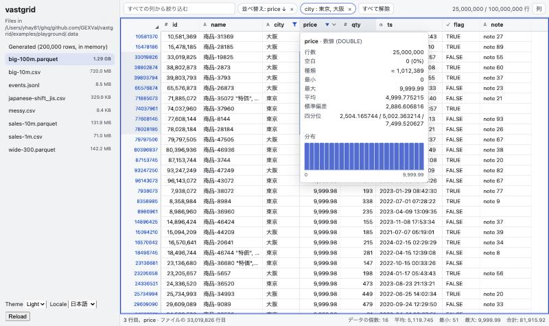
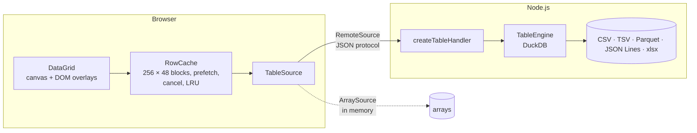

# vastgrid

[](https://www.npmjs.com/package/vastgrid)
[](https://github.com/yhay81/vastgrid/actions/workflows/ci.yml)
[](LICENSE)

A data grid for React that opens CSV, TSV, Parquet and JSON Lines files of any size — gigabytes,
hundreds of millions of rows — and Excel workbooks, and works like a spreadsheet.

**[Try the demo](https://vastgrid.yhay81.com/demo/)** · [Documentation](https://vastgrid.yhay81.com) · [日本語](README.ja.md)

[](https://vastgrid.yhay81.com/demo/)

- **Any size.** Rows are read as you scroll, a block at a time. A 1.4 GB Parquet file with 100 million
  rows opens in 20 ms; the first rows of a 735 MB CSV appear in 0.15 s while the rest loads.
- **Fast.** Cells are drawn on a canvas: about 2 ms per frame for 1,000+ visible cells. Scrolling goes
  past the browser's element-size limit, to billions of rows.
- **A spreadsheet's way of working.** Range selection with the mouse and Excel's keyboard shortcuts,
  copy as TSV / HTML / Markdown, multi-column sort, filters with a searchable value list or conditions,
  AND / OR conditions across columns and nested groups, search across all columns, find (⌘F), column
  statistics, a running count, sum, average, min and max of the selection, formula columns
  (`qty * price`) computed by the engine, grouping by columns with counts, sums, averages, minimums and
  maximums and a totals row (computed by the engine), and export of the current view to CSV, TSV,
  Parquet, JSON or Excel.
- **Bring your engine.** The grid talks to a `TableSource`. Use the DuckDB server engine for files on
  disk, `vastgrid-browser` for files opened in the browser and Parquet URLs, `ArraySource` for data already
  in memory, or implement your own.
- **Safe by construction.** The DuckDB engine only reads files whose real location (links followed) is
  inside the folders you allow, and that cannot be changed while it runs. All SQL is generated; values
  are always parameters.
- **Japanese and English** built in, light and dark themes through CSS variables, ARIA grid semantics
  and full keyboard operation.

## Packages

| Package | Contents |
| --- | --- |
| [`vastgrid`](packages/react) | The `DataGrid` component (canvas renderer, interaction, menus, filters, statistics). |
| [`vastgrid-core`](packages/core) | The table protocol, row cache, selection and scroll models, formatting, `ArraySource` and `RemoteSource`. Framework-free. |
| [`vastgrid-duckdb`](packages/duckdb) | A Node.js table server backed by DuckDB, with a Fetch API request handler. |
| [`vastgrid-browser`](packages/browser) | Reads local Parquet, CSV, TSV and JSON Lines files, and Parquet URLs with HTTP Range requests, in a Web Worker, with no server. |

## Requirements

- **`vastgrid`**: React 18 or later, and a browser with the CSS `light-dark()` function: Chrome and Edge 123,
  Firefox 120, Safari 17.5 or later.
- **`vastgrid-duckdb`**: Node.js 20 or later, on a platform DuckDB ships a binary for: Linux (x64 or arm64,
  glibc or musl), macOS (x64 or arm64) or Windows (x64 or arm64).
- **`vastgrid-browser`**: browsers with module workers (Chrome and Edge 80, Firefox 114, Safari 15 or later), and
  a bundler that handles `new Worker(new URL(…, import.meta.url))`. No special headers (COOP/COEP) are needed.
- **`vastgrid-core`** has no dependencies and runs in the same browsers and in Node.js 20 or later.

## Quick start

### Files on a server (Node.js + DuckDB)

```sh
npm install vastgrid vastgrid-duckdb
```

```ts
// app/api/table/route.ts (Next.js) — any framework with Fetch API requests works the same way
import path from "node:path";
import { createTableHandler, TableEngine } from "vastgrid-duckdb";

const root = "/srv/data";
const engine = TableEngine.create({ allowedDirectories: [root], tempDirectory: "/tmp/vastgrid" });

export const POST = createTableHandler({
  engine: () => engine,
  // Map the client's reference to a file, refusing anything outside your folder.
  resolve: (ref) => {
    const file = path.resolve(root, ref);
    if (!file.startsWith(`${root}${path.sep}`)) throw new Error("Not allowed");
    return file;
  },
});
```

```tsx
"use client";
import { DataGrid, RemoteSource } from "vastgrid";
import "vastgrid/styles.css";
import { useMemo } from "react";

export function Table({ file }: { file: string }) {
  const source = useMemo(() => new RemoteSource({ endpoint: "/api/table", ref: file }), [file]);
  return (
    <div style={{ height: 600 }}>
      <DataGrid source={source} />
    </div>
  );
}
```

`vastgrid-duckdb` uses `@duckdb/node-api`, a native module: keep it out of server bundles (for Next.js,
`serverExternalPackages: ["@duckdb/node-api", "@duckdb/node-bindings"]`) and ship the platform package
(`@duckdb/node-bindings-<platform>`, about 120 MB on macOS) with your server.

### Files in the browser (no server)

```sh
npm install vastgrid vastgrid-browser
```

```tsx
import { DataGrid } from "vastgrid";
import { BrowserSource } from "vastgrid-browser";
import { useEffect, useState } from "react";

// A file the user picked (<input type="file">), or a Parquet file at a URL.
export function Table({ file }: { file: File }) {
  const [source, setSource] = useState<BrowserSource | null>(null);
  useEffect(() => {
    const next = new BrowserSource({ file }); // or { url: "https://example.com/data.parquet" }
    setSource(next);
    return () => next.close(); // ends the worker
  }, [file]);
  return <div style={{ height: 600 }}>{source && <DataGrid source={source} />}</div>;
}
```

The file never leaves the browser: a Web Worker reads the parts the grid shows, and sorts, filters and
summarizes local files. A Parquet URL is read with HTTP Range requests; operations that read the whole
table are off for URLs unless `fullScan: true`. See [Files in the browser](https://vastgrid.yhay81.com/guides/browser/).

### Data in memory

```tsx
import { ArraySource, DataGrid } from "vastgrid";

const source = new ArraySource({
  columns: ["name", "born", "field"],
  rows: [
    ["Ada Lovelace", 1815, "Mathematics"],
    ["Grace Hopper", 1906, "Computer science"],
  ],
});

<DataGrid source={source} />;
```

`ArraySource` sorts, filters and summarizes on the main thread; it suits up to a few hundred thousand
rows.

## `DataGrid` props

| Prop | Type | Default | Description |
| --- | --- | --- | --- |
| `source` | `TableSource` | (required) | The table to show. A new source starts a new grid. |
| `locale` | `string` | the browser's language | Locale for numbers and the built-in texts: Japanese for `ja`, English otherwise. |
| `messages` | `Partial<Messages>` | | Replaces some of the built-in texts (see `en` and `ja`). |
| `rowHeight` | `number` | `--vg-row-height` or 24 | Row height in pixels. |
| `headerHeight` | `number` | `--vg-header-height` or 32 | Height of the row of column names in pixels. Rows of `columnGroups` add to the header. |
| `columnGroups` | `ColumnGroup[]` | | Groups of columns named in header rows above the column names; nested groups add rows. |
| `groupHeaderHeight` | `number` | `--vg-group-header-height` or 24 | Height of each header row of groups in pixels. |
| `maxLines` | `number` | `3` | Lines shown at most in cells of columns that wrap (`wrap` in `columnFormats`), 1 to 20. |
| `nullText` | `string` | `""` | Text shown for null cells. |
| `frozenColumns` | `number` | `0` | Columns frozen at the left when the table opens. |
| `frozenRightColumns` | `number` | `0` | Columns frozen at the right when the table opens: the last ones, kept at the grid's right edge. |
| `toolbar` | `boolean` | `true` | Shows the search box, active filters and row count. |
| `statusBar` | `boolean` | `true` | Shows the active cell and the selection summary. |
| `reloadKey` | `unknown` | | Changing it reads the table again, for example when the file changed on disk. Sources that report their changes are read again by themselves. |
| `followTail` | `boolean` | `false` | After the table changed, show its end when the last row was shown (for appended rows, as `tail -f`). |
| `copyLimit` | `number` | `1000000` | Cells that can be copied at once, over all selected ranges. |
| `columnFormats` | `Record<string, ColumnFormat>` | | Display settings by schema column name: label, number and date formats, alignment, a format function, wrapping. |
| `copyValues` | `"raw" \| "formatted"` | `"raw"` | Copy the values with the schema names, or the shown text with the labels. |
| `exportOptions` | `GridExportOptions \| false` | `{}` | The export panel: where files go (`target`, `onExported`) and which formats to offer. `false` hides it. |
| `drawCell` | `(args: DrawCellArgs) => void` | | Draws the visible loaded cells instead of the grid; `args.drawDefault()` draws the standard cell. |
| `cellAction` | `(cell: GridCellContent) => CellAction \| null` | | Makes cells links or buttons: pointer, underline, screen reader role, `onCellClick` on click and Space. |
| `formulas` | `FormulaColumn[]` | | Formula columns (`{ name, expression }`), applied on start and whenever a different value is passed. |
| `onFormulasChange` | `(formulas: FormulaColumn[]) => void` | | Called when formula columns are added, edited or deleted. |
| `onQueryChange` | `(query: ViewQuery) => void` | | Called when the sort, filters or search change. |
| `onSelectionChange` | `(event: GridSelectionEvent) => void` | | Called when the selection or the active cell changes. |
| `onColumnsChange` | `(event: GridColumnsEvent) => void` | | Called when the columns' width, order, visibility or freezing change. |
| `onCellClick`, `onCellDoubleClick` | `(event: GridCellEvent) => void` | | Called for a click (or Space) and a double click (or F2) on a cell. `preventDefault()` on a double click keeps the cell inspector (or the cell editor) closed. |
| `readOnly` | `boolean` | `false` | Offers no editing, also when the source can write cells. |
| `validateCell` | `(cell: GridCellValidation) => string \| null \| undefined \| Promise<…>` | | Checks a value before it is written; return a message to refuse it. |
| `onCellsChange` | `(event: GridCellsChangeEvent) => void` | | Called when edited cells were saved, or failed to save. |
| `onHistoryChange` | `(state: GridHistoryState) => void` | | Called when what can be undone or redone changes. |
| `initialState` | `GridState` | | Settings applied when a grid starts, once the table's columns are known. |
| `onStateChange` | `(state: GridState) => void` | | Called with the settings when the query or the column settings change. |
| `checkboxSelection` | `boolean` | `false` | Shows a checkbox for each row, and one for every row in the corner. |
| `rowKey` | `string` | the row's position | Schema column whose values identify the rows (a primary key), for checked rows that survive new data. |
| `rowSelection` | `RowSelection` | | Checked rows to apply on start and whenever a different value is passed. |
| `onRowSelectionChange` | `(event: GridRowSelectionEvent) => void` | | Called when rows are checked or unchecked, by the user, the app or the grid. |
| `detailOpen`, `defaultDetailOpen` | `boolean` | `false` | Shows the detail panel with every column of the active row (controlled, or initially). |
| `onDetailOpenChange` | `(open: boolean) => void` | | Called when the detail panel is opened or closed by the user or the handle. |
| `detailPanel` | `ComponentType<DetailPanelProps>` | `DetailFields` | Replaces the content of the detail panel. |
| `className`, `style` | | | Added to the root element (`.vg-root`). |
| `aria-label` | `string` | `messages.gridLabel` | The grid's name for screen readers. |

A ref gives a `DataGridHandle`: `focus()`, `reload()`, `getQuery()`, `setQuery(query)`, `getState()`,
`applyState(state)`, `goToRow(row)`, `undo()`, `redo()`, `history`, `save()`, `openDetail({ focus })`, `closeDetail()`, `detailOpen`, `openExport()`, `getFormulas()`, `setFormulas(formulas)`, `getRowSelection()`, `setRowSelection(selection)`, the `controller` with the grid's state, and the canvas `renderer` (for
diagnostics such as `renderer.timings()`).

Events give a cell's `row` in the view, its `rowId` in the original table, its visible column `col` and its
`column` in the table schema, and are sent only for changes, never for scrolling or drawing. `GridState` is
versioned JSON with the query and the columns' order, set widths, visibility and freezing, kept by column
name; the app chooses where to save it. See the [DataGrid reference](https://vastgrid.yhay81.com/reference/data-grid/#events).

```tsx
<DataGrid
  source={source}
  initialState={saved}
  onStateChange={(state) => localStorage.setItem("grid", JSON.stringify(state))}
  onSelectionChange={({ active }) => showDetail(active.rowId)}
/>
```

```tsx
const grid = useRef<DataGridHandle>(null);

<DataGrid ref={grid} source={source} onQueryChange={(query) => saveQuery(query)} />;

// Largest values of the third column first, only rows that contain "Tokyo".
grid.current?.setQuery({ sort: [{ column: 2, direction: "desc" }], search: "Tokyo" });

// (column 0 is Tokyo or column 1 is over 100,000) and column 2 is not "cancelled".
grid.current?.setQuery({
  filters: [{ type: "values", column: 2, values: ["cancelled"], exclude: true }],
  where: {
    type: "or",
    filters: [
      { type: "values", column: 0, values: ["Tokyo"] },
      { type: "compare", column: 1, op: "gt", value: 100_000 },
    ],
  },
});
```

`filters` all apply; `where` is a condition tree of `and` and `or` groups (nested up to 8 levels) that
also applies. In the grid, "Conditions…" in the toolbar and "Add condition (AND / OR)" in a column's filter
panel build one, and the toolbar shows it with a button to remove it. Sources run condition trees when
they report `capabilities.conditions` (the DuckDB engine, `vastgrid-browser` and `ArraySource` do); the
grid leaves them out otherwise.

### Frozen columns

`frozenColumns` keeps the first visible columns at the left and `frozenRightColumns` the last ones at the
right (a total or an actions column), while the columns between them scroll. The column menu and the
"Columns" panel freeze columns at either side, and `controller.setColumnPin(column, "left" | "right" |
null)` does it from the app. Frozen columns take at most three quarters of the grid's width; beyond that,
those at the right and then those at the left scroll until the grid is wide enough again. `GridState`
and `onColumnsChange` include both sides (`frozenRightColumns`, `GridColumn.pin`), and states saved with
only `frozenColumns` still apply. See the
[DataGrid reference](https://vastgrid.yhay81.com/reference/data-grid/#frozen-columns).

```tsx
<DataGrid source={source} frozenColumns={1} frozenRightColumns={2} />
```

### Column formats

`columnFormats` sets how columns look, by their schema names. The settings change only what is shown:
sorting, filters, search, statistics and exports work on the values themselves, and 64-bit integers
and decimals keep all their digits.

```tsx
const formats: Record<string, ColumnFormat> = {
  price: { label: "Price", number: { style: "currency", currency: "USD" } },
  share: { number: { style: "percent", fractionDigits: 1 } },
  ordered_at: { label: "Ordered", date: { pattern: "yyyy/MM/dd HH:mm" } },
  status: { align: "center", format: (value, { text }) => (value === "ok" ? "✓" : text) },
};

<DataGrid source={source} columnFormats={formats} />;
```

Copies hold the values and the schema names unless `copyValues="formatted"` (or a column's `copy`
setting) asks for the shown text and the labels.

`wrap: true` shows a column's text on up to `maxLines` lines (3 by default), breaking at spaces and
between Japanese, Chinese and Korean characters and at line breaks in the value; longer text ends with
"…". All rows keep one height (`rowHeight` plus `--vg-line-height` per further line while a visible
column wraps), so scrolling stays exact for any number of rows. See the [DataGrid reference](https://vastgrid.yhay81.com/reference/data-grid/#column-formats).

### Column groups

`columnGroups` names groups of columns in header rows above the column names (multi-row headers).
Members are schema column names or nested groups, which add a row each. Groups change only the header:
sorting, filters, column menus, selection, events (`col` and `column`) and `GridState` work on the
columns as before.

```tsx
const groups: ColumnGroup[] = [
  { name: "Sales", children: [
    { name: "Q1", children: ["jan", "feb", "mar"] },
    { name: "Q2", children: ["apr", "may", "jun"] },
  ] },
];

<DataGrid source={source} columnGroups={groups} groupHeaderHeight={24} />;
```

Groups follow their columns. When moving, hiding or freezing columns leaves a group's visible columns
apart, or some frozen and some scrolling, its header is split and each part shows the name. Clicking a
group header selects its columns (Shift extends, ⌘/Ctrl adds); dragging the header of a selected group
moves its columns together. Copies and exports keep one header row, the column names. See the
[DataGrid reference](https://vastgrid.yhay81.com/reference/data-grid/#column-groups).

### Detail panel

The detail panel shows every column of the active row, with the columns' labels and formatted values,
beside the grid, or below it when the grid is narrower than 640px. Rows keep their height. It follows the
active cell (the `active` of `onSelectionChange`); text that the table cuts is read in full for that row,
after a short pause, and moving on cancels the read. After sorting or filtering, it shows the new active
row, the first one; reading a changed table again keeps the active row and reads its record anew. Alt+Enter or the cell menu opens it, Alt+Enter again
moves the focus into it, and Esc closes it. Pass a component to show the record your own way:

```tsx
function Customer({ values, schema, status, rowId }: DetailPanelProps) {
  if (status === "loading") return <p>Loading…</p>;
  const field = (name: string) => values[schema.findIndex((column) => column.name === name)];
  return <CustomerCard id={rowId} name={String(field("name"))} notes={String(field("notes"))} />;
}

<DataGrid source={source} defaultDetailOpen detailPanel={Customer} />;
```

`--vg-detail-width` and `--vg-detail-height` set its size. See the [DataGrid reference](https://vastgrid.yhay81.com/reference/data-grid/#detail-panel).

### Files that change

A grid reads its table again when the source reports that the table changed, and keeps the query, the
column settings, the scroll position and the active cell. `RemoteSource` asks the server every 2 seconds
while a grid shows the table; `vastgrid-duckdb` sees appended rows and rewrites by the file's size,
modification time and a hash of its beginning. Changes reported close together are read once.

```tsx
const source = useMemo(
  () => new RemoteSource({ endpoint: "/api/table", ref: "logs/app.csv", changes: pollChanges({ interval: 1000 }) }),
  [],
);

<DataGrid source={source} followTail />; // stays at the end while rows are appended
```

Only the whole table is reported, never single rows: the grid reads it again, which for DuckDB means
loading the file again. `changes: false` turns watching off, and another `ChangeTransport` (for example
one that listens to server-sent events) can replace polling. `BrowserSource` watches files at a URL by
their `ETag`, `Last-Modified` or size (`changeInterval`, 5 seconds by default); local files cannot be
watched, since the browser refuses to read a `File` that changed on disk.

### Cell colors and custom drawing

A column's `style` colors cells by value and keeps the standard drawing. `drawCell` draws cells on the
canvas itself, with the cell's rectangle, value, type, text, selection state and theme, and can call the
standard drawing first. `cellAction` makes cells links or buttons: the pointer changes over them,
links are underlined, the active cell gets the `link` or `button` role for screen readers, and a click
or Space calls `onCellClick` (Enter and the arrows still move, as in spreadsheets). The hooks run only
for the loaded cells on screen.

```tsx
const formats: Record<string, ColumnFormat> = {
  balance: { style: (value) => (Number(value) < 0 ? { color: "#b42318", background: "#fdecea", description: "Overdrawn" } : null) },
};
const drawCell: DrawCell = (args) => {
  args.drawDefault();
  if (args.schema.name === "status" && args.value === "new") {
    args.ctx.fillStyle = args.theme.accent;
    args.ctx.fillRect(args.rect.x + 2, args.rect.y + 6, 3, args.rect.height - 12);
  }
};
const cellAction: CellActionHook = (cell) => (cell.schema.name === "url" ? { kind: "link", label: `Open ${cell.text}` } : null);

<DataGrid
  source={source}
  columnFormats={formats}
  drawCell={drawCell}
  cellAction={cellAction}
  onCellClick={(event) => event.column === urlColumn && window.open(String(event.value))}
/>;
```

See the [DataGrid reference](https://vastgrid.yhay81.com/reference/data-grid/#cell-colors-and-custom-drawing).

### Checked rows

`checkboxSelection` adds a checkbox to each row, separate from the cell selection. Checked rows are kept
by key, so the same records stay checked when the view is sorted or filtered, and rows hidden by a filter
stay checked. A key is the row's position in the file (`rowId`), valid for one `TableInfo.revision`: a new
revision unchecks every row. With `rowKey`, keys are the values of that column and survive new data; keys
of removed rows stay until the app or the user removes them.

The corner checkbox checks every row without listing keys: `{ type: "exclude", keys: [] }` is every row of
the table except `keys`, and with filters or a search it is every row matching them
(`query: { filters, search }`). Views with those filters (and maybe more) show each row's state; in other
views the grid lists the keys of up to 100,000 matching rows (reason `query`), and larger selections stay
as they are, their rows shown as unknown. Checked rows are not part of `GridState`.

```tsx
const [checked, setChecked] = useState<RowSelection>({ type: "include", keys: [] });

<DataGrid
  source={source}
  checkboxSelection
  rowKey="order_id"
  rowSelection={checked}
  onRowSelectionChange={({ selection, count }) => {
    setChecked(selection);
    showCount(count); // null while the rows matching a filter are not counted
  }}
/>;
```

### Exporting

The toolbar's "Export" button opens a panel to write the current view (filters, search and sort as shown)
or the whole table, with the shown columns in display order or all of them, in the formats the source
offers (`info().exports`). The DuckDB server writes CSV, TSV, Parquet, JSON and Excel files into the
folders you allow (only with `resolveTarget`), so large results never pass through the browser;
`ArraySource` returns CSV, TSV, JSON and Excel files that the browser downloads. Excel files are written
without dependencies, as a stream, with the labels of `columnFormats` as headers and their number and
date formats; text is never written as a formula, and more than 1,048,575 rows are refused.

```tsx
<DataGrid
  source={source}
  exportOptions={{
    // The server resolves this in `resolveTarget`; then offer the file for download.
    target: ({ request }) => `exports/${request.target}`,
    onExported: (result) => window.location.assign(`/downloads/${encodeURIComponent(result.target)}`),
  }}
/>
```

See [Exporting](https://vastgrid.yhay81.com/guides/export/).

### Editing cells

The grid edits sources that can write cells (`capabilities.edit`): `ArraySource` with `editable: true`,
and the DuckDB server when its engine is created with `editable: true`; other sources stay read-only.
Typing replaces the active cell (IMEs work: the editor is a text field over the cell), F2 or a double
click edits it, Enter or Tab saves and moves, Esc cancels, Delete clears the selected cells, and ⌘/Ctrl +
V pastes ranges copied from Excel or Google Sheets (TSV or HTML tables), checking every value first. ⌘/Ctrl
+ D and ⌘/Ctrl + R fill the first row or column of the selection down or right, and ⌘/Ctrl + Z and ⌘/Ctrl +
Shift + Z undo and redo whole writes (a paste or a fill at once), keeping types and digits. Values
are checked against the column's type without losing digits (64-bit integers and decimals stay text) and
by `validateCell`, which may be asynchronous. Writes show while they save, and failures and conflicts with
other users' changes offer Retry, Overwrite or Discard. The DuckDB server can save edited cells back into
CSV and TSV files with `saveFiles` (⌘/Ctrl + S), rewriting only the edited fields and keeping every other
byte — quoted line breaks, encodings such as Shift_JIS, the final line break — through a temporary file,
and refusing files changed by someone else meanwhile. After a write the grid reads the rows again and,
when the sort or filters use the written column, sorts and filters again; statistics, summaries and
exports read the new values. The DuckDB engine keeps written values apart from the file until they are saved.

```tsx
<DataGrid source={new ArraySource({ columns, rows, editable: true })} onCellsChange={(event) => save(event)} />
```

See [Editing cells](https://vastgrid.yhay81.com/guides/editing/).

### Formula columns

"Add formula column…" in a column's menu adds a column computed per row by an expression, such as
`qty * price` or `IF(due < '2024-07-01', 'late', '')`. The source evaluates it — the DuckDB engine in SQL,
without moving the table to the browser — so it sorts, filters, shows statistics and selection summaries,
and is exported like a column of the file. The editor checks the formula as it is typed and shows what is
wrong. Formulas are a small language of their own (columns by name, arithmetic, `&` for text,
comparisons, `AND` / `OR` / `NOT`, and functions for numbers, text, dates and blanks); they are never run
as JavaScript or SQL, and the engine makes SQL from them with quoted names, parameters and a fixed list of
functions.

```tsx
<DataGrid
  source={source}
  formulas={[
    { name: "total", expression: "qty * price" },
    { name: "with tax", expression: "ROUND(total * 1.1, 2)" },
  ]}
  onFormulasChange={(formulas) => save(formulas)}
/>
```

Formula columns follow the table's columns (formula `i` is column `info.columns.length + i`), are kept in
`GridState` and follow their columns by name. The DuckDB engine and `ArraySource` evaluate them
(`capabilities.formulas`); `vastgrid-browser` does not yet. See [Formula columns](https://vastgrid.yhay81.com/guides/formulas/).
### Grouping and totals

"Group" in the toolbar groups the rows that the filters keep by one or more columns and shows the
groups as a table: the keys, then counts, sums, averages, minimums and maximums. "Total in the bottom
row…" in a column's menu shows an aggregate of the column in a row fixed below the rows. The source
computes both (`group`, with `capabilities.group`): `ArraySource`, the DuckDB server (one generated SQL
statement) and `vastgrid-browser` with `fullScan`. Results hold at most `limit` groups (1,000 by default);
sums of integers and decimals are exact. A cross tabulation turns the values of chosen columns into
columns (`Tokyo / sum(amount)`), and is refused with a notice when it would make more than 200 columns.
All of it is part of `GridState`.

```ts
const result = await source.group({ view: null, keys: [0], aggregates: [{ fn: "count" }, { fn: "sum", column: 2 }] });
// { columns: [region, count(*), sum(amount)], rows: [["Tokyo", 120, "53210.50"], …], groups: 47, truncated: false }
```

See [Grouping and totals](https://vastgrid.yhay81.com/guides/grouping/). The same bounded results feed
charts drawn by the library of your choice, following the grid's filters and sort; vastgrid itself
depends on no chart library. See [Charts](https://vastgrid.yhay81.com/guides/charts/) and the playground's
"Chart" panel.

## Performance

`npm run bench -- --csv-rows=10000000 --parquet-rows=100000000` on an Apple M2 Pro (12 threads, 32 GB),
Node.js 24, DuckDB 1.5. Times include DuckDB but not HTTP.

| Operation | Time |
| --- | ---: |
| CSV 735 MB, 10M rows: first rows readable | 143 ms |
| CSV: fully loaded (sort, filter and statistics available) | 5.3 s |
| CSV: 256 rows × 8 columns at a random position (median) | 1.8 ms |
| CSV: sort by a number / text column | 1.2 s / 1.1 s |
| CSV: filter by values (2.5M rows) / search all columns | 293 ms / 544 ms |
| CSV: column statistics (histogram, quartiles) | 117 ms |
| CSV: sum, average, min, max of 1M rows × 2 columns | 7.8 ms |
| Parquet 1.38 GB, 100M rows: open (read in place) | 20 ms |
| Parquet: 256 rows × 8 columns at a random position (median) | 24 ms |
| Parquet: sort by a number column | 1.9 s |
| Parquet sorted: 256 rows at a random position (median / 95th percentile) | 147 ms / 208 ms |

Rendering a 2280 × 1371 px viewport (56 rows × 20 columns) takes 2.0 ms per frame at the median and
3.0 ms at the 99th percentile, measured with the canvas flushed after every frame. Column styles,
`cellAction` and a `drawCell` that adds a mark to the standard drawing keep a frame of 1,349 cells
within the variation of the measurement (2.5–2.8 ms against 2.7–2.8 ms without them).

## How it works



- **Scrolling.** A transparent native scroller sits over the canvas, so wheel, trackpad and scrollbar
  behave natively. Browsers cap element sizes (about 16.7M px in Chromium), so `ScrollAxis` maps the
  native position to a virtual one: small movements move by the same amount, while large jumps and the
  two ends map proportionally.
- **Loading.** On every frame the grid declares the visible rows and columns. `RowCache` loads the
  missing blocks (visible first, then one screen ahead and behind), cancels requests that scrolled far
  away and drops the least recently used blocks.
- **Engine.** Delimited and JSON files become DuckDB tables in a database file of the session; the first
  1,000 rows are served from a preview while the file loads. Parquet files are read in place by row
  position. Shift_JIS, EUC-JP and BOM-marked UTF-16 (both byte orders) are converted to UTF-8 first. Sorting and filtering
  build a view: a sorted copy for tables up to 20M rows (2 ms windows), or only the order of the rows
  for larger ones (seconds instead of minutes, and a fraction of the temporary space). Sorts of tables
  with 1M rows or more show their first 1,000 rows in about a second, from a top-N query in the order of
  the finished view, while the rest is built in the background.
- **Protocol.** `RemoteSource` speaks a small JSON protocol (see [docs/protocol.md](docs/protocol.md)).
  It reopens tables and recreates views when the server forgets them, for example after a restart.

## Keyboard

| Keys | Action |
| --- | --- |
| Arrows · Page Up/Down · Home/End | Move the active cell |
| ⌘/Ctrl + arrows · ⌘/Ctrl + Home/End | Jump to the first or last row or column |
| Shift + any of the above · Shift + click | Extend the selection |
| ⌘/Ctrl + click | Add a range (ranges with the same rows or the same columns copy together) |
| Tab / Enter (with Shift: backwards) | Move within the selection |
| Shift + Space · Ctrl + Space · ⌘/Ctrl + A | Select the row · the column · everything |
| Space · ⌘/Ctrl + Shift + Space (with `checkboxSelection`) | Check the active row · every row (shift-click checks a range) |
| ⌘/Ctrl + C · ⌘/Ctrl + Shift + C | Copy · copy with headers |
| ⌘/Ctrl + F | Find |
| Alt + ↓ | Column menu (sort, filter, statistics, freeze at the left or the right, hide) |
| F2 · double click | Show the full value of the cell (edit it, in a grid that edits) |
| Typing · Delete · ⌘/Ctrl + V (in a grid that edits) | Replace the active cell's value · clear the selected cells · paste |
| ⌘/Ctrl + D · ⌘/Ctrl + R (in a grid that edits) | Fill down · right from the selection's first row or column |
| ⌘/Ctrl + Z · ⌘/Ctrl + Shift + Z or Ctrl + Y (in a grid that edits) | Undo · redo the last write |
| ⌘/Ctrl + S (sources that save, such as the DuckDB server with `saveFiles`) | Save the edited cells into the file |
| Alt + Enter (again: into the panel) · Esc | Open the detail panel of the active row · close it |
| Shift + F10 · context menu key · right click | Cell menu (copy, filter to value, sort) |

## Theming

Every color, font and size is a CSS custom property on `.vg-root`, and the canvas reads them, so a few
lines of CSS restyle everything:

```css
.my-app .vg-root {
  --vg-font-family: "Inter", sans-serif;
  --vg-bg: var(--surface);
  --vg-fg: var(--text);
  --vg-accent: var(--brand);
  --vg-selection-bg: color-mix(in srgb, var(--brand) 15%, transparent);
}
```

See [`packages/react/src/styles.css`](packages/react/src/styles.css) for the full list. Colors use
`light-dark()` and follow `color-scheme`; forced-colors mode is supported.

## Development

```sh
npm install
npm run dev        # playground at http://127.0.0.1:5174 (files in examples/playground/.data)
npm run dev -w vastgrid-site   # documentation and demo at http://localhost:4321
npm run generate -w vastgrid-playground   # sample files, add --large for 100M rows
npm test
npm run lint
npm run bench
```

## Roadmap

The unreleased v2 rebuild is tracked in [#33](https://github.com/yhay81/vastgrid/issues/33). Its typed-value contract rejects values that Arrow cannot preserve; float32 text input is rounded before writing, and numeric overflow is rejected. See the [v2 specification](docs/v2-spec.md#22-values-in-json). Its DuckDB engine writes cells of CSV, TSV, Parquet, JSON and Excel files, kept apart from the file until they are saved, with conflict checks and undo in the grid (§7.2), and saves them into CSV and TSV files with every byte that was not edited kept as it is (§7.5). Files that change on disk are read again, and unsaved edits are kept until they are discarded (§7.6). Views are exported as CSV, TSV, Parquet, JSON and Excel on the server (§8.2). Derived columns are written as formulas in v1's language, which compiles to plan expressions, and v1's saved formulas migrate with what uses them (§4.11, §5.6); the toolbar's Formulas menu adds, changes, renames and removes them.

The items of the earlier roadmap (cell editing with byte-preserving CSV write-back, formula columns) are
done; plans are tracked in the GitHub issues. See [docs/research.ja.md](docs/research.ja.md) (Japanese) for the survey of existing viewers and grids
that shaped these choices.

## License

MIT
