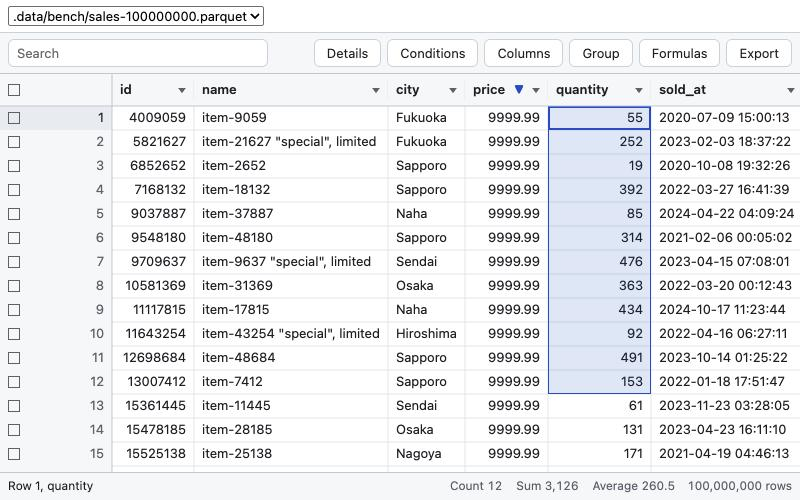

# vastgrid

[](https://www.npmjs.com/package/vastgrid)
[](https://github.com/yhay81/vastgrid/actions/workflows/ci.yml)
[](LICENSE)

vastgrid opens huge CSV, TSV, Parquet, JSON Lines and Excel files like a spreadsheet, lets people fix them, and
saves them safely. It is a canvas data grid for React with engines for the browser and Node.js, and the same grid
comes as a command, a VS Code extension, an MCP App and a Jupyter widget.

**[Try the demo](https://vastgrid.yhay81.com/demo/)** · [Open a file in the browser](https://vastgrid.yhay81.com/open/) · [Documentation](https://vastgrid.yhay81.com) · [日本語](README.ja.md)

[](https://vastgrid.yhay81.com/demo/)

- **Any size.** Rows are read a block at a time as you scroll, and Parquet files are read in place, also over HTTP
  Range requests. A 100-million-row Parquet file sorts on DuckDB with its first rows ready in under a second.
  Cells are drawn on a canvas, and scrolling renders no React.
- **A spreadsheet's way of working.** Excel's keys and selections, sorting, filters, conditions, search and find,
  groups, pivots and totals, formulas, formats, copy, paste and fill.
- **Edits you can trust.** Typed input is checked against the column's type, writes are checked for conflicts and
  can be undone, and saving a CSV or TSV file rewrites only the edited fields and keeps every other byte. A file
  that changes on disk is followed, and is never saved over. Values that cannot survive a save, including empty
  strings in CSV and TSV, are refused with the edits kept.
- **One state, typed commands.** What the grid shows is a document (the view and its columns) and a session (where
  the person is), controlled or not. Every change is a command that a toolbar, a host or an AI agent can dispatch.
- **Engines you choose.** `vastgrid-js` in memory, in the page or a Web Worker; `vastgrid-duckdb` on Node.js; or
  your own, through a small set of messages.
- **English and Japanese** built in, light and dark themes through CSS variables, ARIA grid semantics and full
  keyboard operation.

## Where to use it

| Where | How | Engine |
| --- | --- | --- |
| A React app | `npm install vastgrid vastgrid-js` ([quick start](#quick-start)) | in memory, a worker, or a server |
| The browser | [vastgrid.yhay81.com/open/](https://vastgrid.yhay81.com/open/): drop a file; it stays in the browser | `vastgrid-js` in a Web Worker |
| The command line | [`npx vastgrid-cli sales.parquet`](https://vastgrid.yhay81.com/apps/cli/) | DuckDB on this computer |
| VS Code | the extension [vastgrid](https://vastgrid.yhay81.com/apps/vscode/) (`yhay81.vastgrid-vscode`) | DuckDB in the extension |
| An AI chat | the MCP server [`vastgrid-mcp`](https://vastgrid.yhay81.com/apps/mcp/) with its MCP App | DuckDB in the MCP server |
| A Jupyter notebook | [`pip install vastgrid`](https://vastgrid.yhay81.com/apps/notebook/), then `vastgrid.show(df)` | DuckDB in the kernel |

[Where vastgrid opens files](https://vastgrid.yhay81.com/apps/overview/) compares them: formats, editing, saving
and exporting.

## Quick start

```sh
npm install vastgrid vastgrid-js
```

```tsx
import { DataGrid, localTransport } from "vastgrid";
import "vastgrid/styles.css";
import { memoryEngine } from "vastgrid-js";

const transport = localTransport(
  memoryEngine({
    tables: {
      orders: {
        columns: [
          { name: "id", type: "integer" },
          { name: "customer", type: "string" },
          { name: "price", type: "decimal", precision: 10, scale: 2 },
          { name: "ordered", type: "date" },
        ],
        rows: [
          [1, "Acme", "12.50", "2026-01-31"],
          [2, "Globex", "8.00", "2026-02-01"],
        ],
        editable: true,
      },
    },
  }),
);

export function Orders() {
  return <DataGrid transport={transport} table="orders" style={{ height: 480 }} />;
}
```

For files larger than the page should hold, run the memory engine
[in a Web Worker](https://vastgrid.yhay81.com/guides/browser/), or the DuckDB engine
[on a server](https://vastgrid.yhay81.com/guides/server/). The
[guides](https://vastgrid.yhay81.com/getting-started/) cover state, editing and saving, formulas, grouping,
exporting, theming and your own engine.

## Packages

| Package | Contents |
| --- | --- |
| [`vastgrid`](packages/grid) | The React grid: `DataGrid`, `GridProvider` and the hooks; `vastgrid/core` (the store and the transports, without React), `vastgrid/server`, `vastgrid/styles.css`. |
| [`vastgrid-js`](packages/js) | The memory engine, for the browser and Node.js: rows of typed JSON, Arrow, CSV, TSV, JSON Lines, Excel and Parquet (also over HTTP). |
| [`vastgrid-duckdb`](packages/duckdb-engine) | The DuckDB engine for Node.js: files of any size, writing cells, saving CSV and TSV, following files, exports; an HTTP handler. |
| [`vastgrid-spec`](packages/spec) | The specification as code: types, plan checking, commands, message schemas, the conformance corpus. |
| [`vastgrid-sql`](packages/sql) | Plans as DuckDB SQL. |
| [`vastgrid-cli`](packages/cli) | `npx vastgrid-cli <file>`: a file in a grid in the browser, read by DuckDB on this computer. |
| [`vastgrid-mcp`](packages/mcp) | An MCP server with an MCP App. |
| [`vastgrid-vscode`](packages/vscode) | The VS Code extension; install 0.2.0's VSIX from the [GitHub release](https://github.com/yhay81/vastgrid/releases/tag/v0.2.0). |
| [`vastgrid` (Python)](packages/notebook/python) | The Jupyter widget, on PyPI. |

The npm packages are released together at one version. `vastgrid` needs React 19.3 or later (an optional peer
dependency: servers use `vastgrid/core` without React) and a browser with CSS `light-dark()`: Chrome and Edge 123,
Firefox 120, Safari 17.5 or later. The engines need Node.js 20 or later; DuckDB runs on Linux (x64, arm64; glibc
and musl), macOS (x64, arm64) and Windows (x64, arm64).

## Performance

On an Apple M2 Pro. The grid on a million rows in the memory engine shows its first rows 36–49 ms after mounting
and drops no frame while scrolling at 60 Hz, with no React commit. The DuckDB engine sorts a 100-million-row
Parquet file (1.38 GB) with its first rows ready in 953 ms, and reads a sorted 10-million-row CSV file 256 rows at a
time in 4 ms. [Performance](https://vastgrid.yhay81.com/about/performance/) has every measure and how to repeat
them.

## Documentation

- [vastgrid.yhay81.com](https://vastgrid.yhay81.com): guides, the API reference, the demo and the open page.
- [docs/](docs): the specifications ([spec.md](docs/spec.md) for the engines and their messages,
  [react.md](docs/react.md) for the React package), how each app is built, the benchmarks, and
  [migrating from 0.1](docs/migrating-from-0.1.md).
- [CHANGELOG.md](CHANGELOG.md), and plans in the [GitHub issues](https://github.com/yhay81/vastgrid/issues).

## Contributing

```sh
npm install
npm run build      # every package, the CLI's page, the MCP App and the extension
npm test           # the unit tests, on the sources
npm run dev        # examples/files: the grid on the DuckDB engine, at http://127.0.0.1:5182
```

[CONTRIBUTING.md](CONTRIBUTING.md) has the checks and the guidelines for a change, and
[SECURITY.md](SECURITY.md) how to report a vulnerability.

## License

MIT
