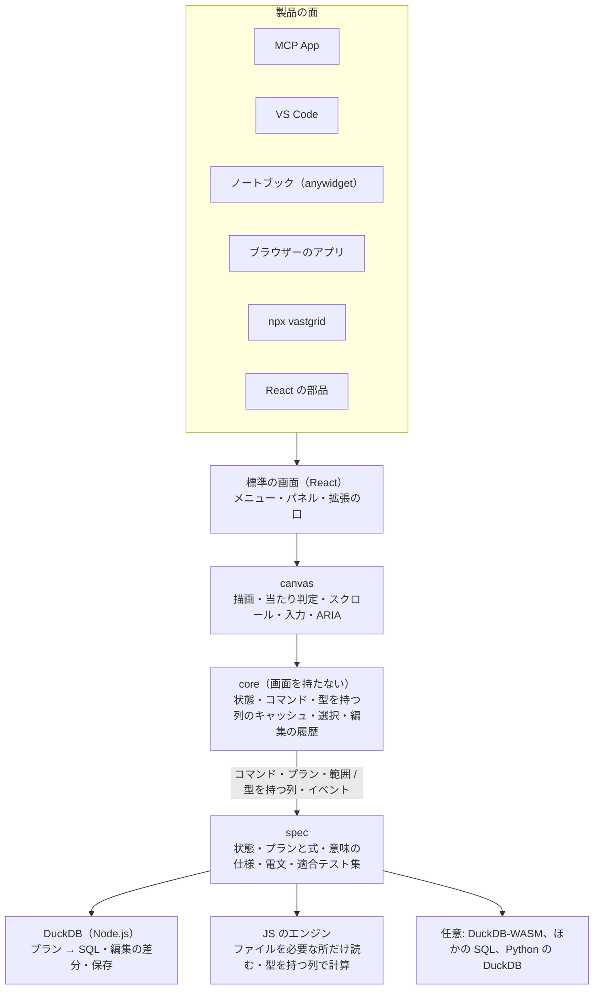

# 作り直すかどうかの再検討

検討日: **2026-10-24**。対象は main（`7fa7bfb`。wave 3 まで統合した状態）と、[作り直すときの設計案](redesign.ja.md)（以下「設計案」。0.1.1 を対象に書いたもの）です。条件は「実装の手間は考えない。最も価値のある OSS になり、改善を続けられる方向を選ぶ」です。測った値、調べた事実、そこからの判断は分けて書きます。

## 要点

**作り直します。ただし、設計案のとおりにではありません。**

作り直す理由は、コードの見た目ではありません。今の背骨（操作ごとのメソッドを並べた `TableSource`、JSON で運ぶ `CellValue`、`GridController` と `DataGrid` に集まる状態）が、次の 2 つを妨げているからです。

1. **改善を続けること。** 機能を足すたびに中心の 2 ファイルを直し、クエリーに関わる機能では 3 つのエンジンも同時に直します。組み合わせの不具合は統合のあとで見つかります。
2. **価値の大きい面に届くこと。** MCP App・VS Code・ノートブックは、画面から切り離して外から操作できる状態と、運び方を選ばない電文がないと作れません。

一方、調べてみると、設計案の背骨（閉じたプラン、Arrow、同じ電文を同じスレッド・Worker・遠隔で運ぶこと、エージェントが JSON の状態を操作すること）は、[Perspective](https://github.com/perspective-dev/perspective)（Apache-2.0、スター 11,342、2 週間ごとのリリース）がすでに持っています。**背骨は差別化になりません。** 差別化になるのは、vastgrid がすでに持っている次のものです。

- 巨大なファイルを表計算のように直し、触っていないバイトを変えずに保存できること（調べた範囲で、同じことをする OSS は見つかりませんでした）
- キャンバスに描く、Excel の操作感のグリッド
- WASM も COOP/COEP も要らない JS だけの画面とブラウザーのエンジン（MCP App の画面は、既定の CSP で WASM を使えません）
- AG Grid や MUI では有料の機能（範囲の選択、Excel への書き出し、グループ化、計算列、サーバー側の行の取得など）が MIT であること

そこで、作り直しは「背骨を差別化の下に敷き直す」ものとし、設計案から次の点を変えます。

| | 設計案 | この再検討 |
| --- | --- | --- |
| 進め方 | 作り直さずに、今のコードを 5 段階で近づける | v2 として背骨を作り直す。今の main は凍結し、振る舞いの基準（参照実装）にする |
| 重心 | データ側の背骨を入れ替える（プラン・Arrow・状態を持たないサーバー）。画面から切り離した状態は 7 つの柱の 1 つ | 画面から切り離した状態とコマンドを最優先にする（MCP App・VS Code・ノートブックの前提で、中心の 2 ファイルを解く鍵でもある）。行のチェックと書き込み中の編集も状態に含め、保存する状態とその場の状態に分ける。次にプラン、編集、型を持つ列 |
| 編集 | 行 ID と差分の置き場所だけ先に入れ、機能は後 | 最大の差別化要因なので、最初から背骨に入れる |
| エンジン | JS のエンジン（Worker）・DuckDB-WASM・Node.js の DuckDB を最初からそろえる | 主役は Node.js の DuckDB（サーバー・CLI・VS Code の拡張・MCP のサーバーはどれも Node.js で動く）。ブラウザーは JS のエンジンを型を持つ列で作り直す。DuckDB-WASM は任意の追加にする |
| Arrow | 行のまとまりをすべて Arrow で運ぶ | 型を持つ列で持つことは必須。運ぶ形は Arrow IPC を標準にする。Node.js の DuckDB には Arrow の出口がないので、画面の分のまとまりを JS で組む |
| ハッシュを識別子にした `GET` とキャッシュ | 中心に置く | 後回し。主な面は同じマシンの Node.js なので、遠隔に置く使い方が出てから |
| 製品の面 | React の部品 | 部品に加えて、MCP App・VS Code・ノートブック・ブラウザーのアプリ・CLI を設計の受け入れ条件にする |
| 位置づけ | 巨大なファイルを素早く調べる | **巨大な CSV・Parquet・Excel を、表計算のように開いて、直して、安全に保存できる。MIT で、どこにでも組み込める** |

wave で入れた機能は捨てません。多くはほかのグリッドで有料の機能で、vastgrid の価値そのものです。v2 では新しい背骨の上に移し、業務画面向けの機能（列のグループ、行のチェック、詳細パネル、セルの操作）は拡張の口の外側に置きます。

## なぜ作り直すか

### 1. 機能を足すほど、足しにくくなっている

0.1.1 から main までの 1 日で、wave 1〜3 の 23 件の機能が入りました。

| | 0.1.1（`674fbc7`） | main（`7fa7bfb`） |
| --- | ---: | ---: |
| ソースの行数（4 パッケージ） | 8,211 | 27,277 |
| テストの行数 | 1,752 | 11,846 |
| `controller.ts` | 945 | 2,615 |
| `data-grid.tsx` | 1,035 | 2,761（React のフック 63 個） |
| `engine.ts`（DuckDB） | 1,207 | 2,423 |
| `types.ts` | 234 | 650 |

- 23 件の機能コミットのうち 21 件が `data-grid.tsx` を、16 件が `controller.ts` を変えています。
- クエリーに関わる機能（条件木、計算列、グループ化、クロス集計、編集、書き出し）は、1 件で 23〜42 ファイルを変え、型・プロトコルの検証・`ArraySource`・DuckDB のエンジン・ブラウザーのエンジン・コントローラー・画面のうち 5〜7 か所を同時に直しています。
- 統合したあとに直した 7 件は、設計案が 0.1.1 の修正に見つけたのと同じ種類です。
  - JS と DuckDB の意味のずれ: NaN・無限大の順序（`d764c22`）、重複した見出しの書き出し（`2e45c21`）
  - 値の型: decimal と float の取り消しでの比較、保存する日付の形式（`0c31474`）
  - 状態と読み直し: 忘れられたビューの作り直し（`b6d1a4b`）、読み直しで詳細パネル・チェック・グループを保つ（`e3cf9e8`・`2e45c21`・`d764c22`）
  - 機能の組み合わせ: 複数範囲のコピーと並べ替えの先行表示（`c988589`）、列グループと右の固定（`6e0165f`）

並行して機能を足すほど中心の 2 ファイルで衝突し、組み合わせの不具合が統合のあとに見つかります。並行したセッションで開発を続けるなら、ここが一番の妨げです。

wave の機能は、設計案のプランの操作に 1 つずつ対応しますが、それぞれ別の型・別のメソッド・別の実装になっています。

| 入った機能 | 今の形 | プランでは |
| --- | --- | --- |
| 条件木 | `ViewQuery.where`（`filters` と並存） | `filter`（式の木） |
| 計算列 | `ViewQuery.formulas`。列の番号は `columns.length + i` | `derive` |
| グループ化・合計の行 | `TableSource.group`（独自の `sort`・`limit`） | `aggregate` |
| クロス集計 | `GroupRequest.pivot` | `aggregate`（列の軸つき） |
| グループの表の並べ替え・絞り込み | `GroupedSource`。並べ替えはエンジンに聞き直し、絞り込みと統計は画面の `ArraySource` | `aggregate → filter → sort → slice` をエンジンで |
| 値の一覧・統計・選択範囲の集計・検索 | 専用のメソッド 4 つ | `aggregate`・`filter`・`slice` の組み合わせ |

`TableSource` は 14 のメソッドと 14 の能力の旗を持つようになりました。エンジンを足す人は、これをすべて同じ意味で書く必要があります。

### 2. 価値の大きい面は、今の背骨では作れない

| 面 | 要ること | 今の背骨で足りないこと |
| --- | --- | --- |
| MCP App | エージェントが表示の状態を渡し、読み取る。画面は WASM なしで動く | `GridState` はクエリー・列・計算列・グループまで。選択・スクロール・行のチェック・編集は `GridController` の中にあり、React の `DataGrid` と一体で、画面の外から読み書きする形になっていない |
| VS Code | 拡張のプロセス（Node.js）と webview の間で同じ電文を運ぶ | `RemoteSource` は HTTP の受け口とサーバーのハンドルが前提 |
| ノートブック | Python の DuckDB・Polars から型を持つ列で返す | 14 のメソッドを Python で同じ意味に書き直す必要がある。値は JSON で、64 ビット整数・decimal・日時は文字列 |
| ほかのデータベース | Postgres・ClickHouse などに SQL を任せる | 同じく 14 のメソッドを書く |

### 3. 少しずつ移す理由が、今はない

設計案が段階的な移行を選んだ理由は「現実的」で、主に手間を減らすためと読めます。手間を考えないと、残る理由は「使っている人を壊さない」「いつも動く」「途中で学べる」です。

- **使っている人がいない。** GitHub のスターとフォークは 0、npm の `vastgrid` は 2026-10-16〜22 の 1 週間で 4 ダウンロード、公開から 4 日です。
- **変える範囲が広い。** ソースの 68 ファイル中 40 ファイル、27,016 行中 21,233 行（79%）が、置き換える対象（`CellValue`・`TableSource`・`ViewQuery`・`RowBlock`・`ViewInfo`・`GridController`）を参照しています。少しずつ移しても、ほぼすべてを書き換えます。
- **残りが固定されやすい。** 少しずつ移すと、2 つの値の形（JSON と型を持つ列）と 2 つの契約（メソッドとプラン）を並べて持つ期間が長くなり、`filters` と `where` のような重なりが残ります。
- 「いつも動く」「学べる」は、v1 を凍結して使える状態に保ち、v2 を縦に薄く切って作れば得られます。

## 調べて分かったこと

調査は 2026-10-24 に、GitHub・npm・PyPI・VS Code Marketplace の API と、公式の文書・リリースノート・ソースで行いました。判断に効く項目のうち、MCP Apps の WASM の課題、Positron の切り替え、Node.js の DuckDB の Arrow の課題、Perspective の版とライセンスは、GitHub で照合しました。

### 設計案の背骨は、すでにある

- [Perspective](https://github.com/perspective-dev/perspective) 5.6.1（2026-10-23、Apache-2.0、OpenJS Foundation）は、表示の設定（JSON の `ViewConfig`）をエンジンのクエリーに直す Virtual Server を持ち、DuckDB（4.1.0、2026-01）、ClickHouse、Polars に対応しています。4.4.0 で Arrow IPC を使い、同じ電文を同じスレッド・Web Worker・遠隔のサーバーで運びます。5.2.0 では LLM のエージェントが JSON の設定を読み書きします。anywidget と React の部品もあります。
- ただし、グリッドは DOM で描く `regular-table`、編集は Perspective の表への書き込みで、元のファイルには書き戻しません。エンジンは C++ の WASM、画面（`perspective-viewer`）も WASM で動くので、MCP App の画面には載りません。Perspective の上に vastgrid を載せる案も、この 2 点で合いません。

**判断:** プラン・Arrow・運び方を選ばない電文は、改善を続けるための衛生として作る。売りにはならない。

### ブラウザーで巨大なファイルを扱う道は、DuckDB-WASM ではない

- DuckDB-WASM は wasm32 だけで、メモリは 4 GB まで（2 GiB を超えると不具合の報告あり）。Memory64 の版はなく、複数スレッドは試験的で COOP/COEP が要ります。`duckdb-eh.wasm` は brotli で約 7.1 MB です。最後の GitHub リリースは v1.33.0（2025-12）です。
- Memory64 は Chrome 133・Firefox 134 で使えますが、Safari はフラグの裏です。
- Positron は 2026-06-04 に、データの画面の DuckDB を WASM から Node.js のネイティブに切り替えました（[PR #13967](https://github.com/posit-dev/positron/pull/13967)）。理由は、圧縮された CSV を読めない、実質 1 スレッド、ファイル全体を 4 GB のヒープに写すことでした。
- MCP Apps の画面は既定の CSP で WebAssembly を使えません（[ext-apps #605](https://github.com/modelcontextprotocol/ext-apps/issues/605)、2026-04 から未解決）。

**判断:** 巨大なデータの計算は Node.js の DuckDB に任せる。ブラウザーの JS のエンジン（ファイルを必要な所だけ読む、WASM も COOP/COEP も要らない）は強みとして残し、計算を型を持つ列で作り直す。今は並べ替えの列を `CellValue` の配列に集めるため、1,000 万行の Parquet で並べ替えに 6.3 秒、並べ替えた最初の 100 行に 8.3 秒かかります（この検討で既存のベンチマークを実行。DuckDB のエンジンでは並べ替え 1.3〜1.6 秒、最初のまとまり 2〜6 ms）。

### Node.js の DuckDB には、Arrow の出口がない

- `@duckdb/node-api` に Arrow で結果を返す API はなく（[node-neo #45](https://github.com/duckdb/duckdb-node-neo/issues/45)、2024-11 から未解決）、インストール済みの 1.5.6-r.1 の型定義にもありません。回避策はコミュニティの拡張（nanoarrow の `to_arrow_ipc()`）ですが、拡張を読み込むのは隔離の方針と合いません。
- ブラウザー側は [Flechette](https://github.com/uwdata/flechette) 2.7.1（gzip で約 14.5 KB、Mosaic が使用）が成熟しています。
- DuckDB 2.0.0 が 2026-10-21 に出ました（LTS）。`@duckdb/node-api` 2.0.0-r.1 のリリースノートは不具合がほぼ確実にあると書いています。1.5 の保守は 2027-03 までです。

**判断:** 型を持つ列は必須にし、Node.js では画面の分のまとまり（256 行程度）を JS で Arrow に組む。量が小さいので重くない。公式の API が出たら差し替える。

### 空いている場所: 巨大なファイルを、直して保存できる表計算

- 大きなデータの表計算は閉じつつあります。Row Zero は Databricks が買収（2026-09-24 発表）、Quadratic は 2026-03 に非公開に移りました（公開リポジトリは 404）。
- OSS のグリッドは止まり気味です。Glide Data Grid は安定版が 2024-02 の 6.0.3 で、最後のコミットは 2026-01-21。HighTable は 0.26.4 から更新がありません。Tad も止まっています。
- 調べた範囲の OSS は、どれも閲覧が中心です（Perspective、HighTable、quak、buckaroo、itables、Arbalister）。Positron のデータの画面は機能が近いものの、IDE の中だけで、ライセンスは Elastic License 2.0 です。
- AG Grid は Enterprise（開発者 1 人 999 ドル）で、範囲の選択、クリップボード、Excel への書き出し、グループ化・集計・ピボット、計算列、サーバー側の行の取得、AI からの状態の操作を提供します。MUI X は Pro・Premium で、サーバー側の取得、セルの選択、Excel への書き出し、グループ化・集計・ピボット、計算列、取り消しを提供します。
- VS Code の CSV の需要は大きく（調査時点で Rainbow CSV が約 2,470 万、Edit CSV が約 250 万インストール）、Edit CSV は大きなファイルに向かないと README に書いています。

### MCP App が、標準の画面になった

- MCP Apps は 2026-01-26 に最初の公式の拡張として安定版になり、Claude・ChatGPT・VS Code などが対応しています。SDK は週に約 357 万ダウンロードです。
- 公式の例にデータのグリッドはありません。画面は iframe で、サーバーのツールを呼び、`ui/update-model-context` で自分の状態をモデルに渡せます。
- エージェントから表の状態を操作する機能は、AG Grid（Enterprise）と MUI X（Premium）では有料です。

**判断:** 「サーバーは Node.js の DuckDB、画面は JS だけのキャンバスのグリッド、状態は JSON で読み書きできる」形が、MCP App にそのまま合います。編集と保存まで含めると「エージェントに CSV を直させ、グリッドで確かめて保存する」ができます。

## v2 の形

運び方（同じスレッド、Worker の postMessage、HTTP、MCP のツールの呼び出し、VS Code の webview、ノートブックの comm）は、どれも同じ電文を運ぶだけにします。電文は要求と応答だけで成り立つようにし（MCP のツールの呼び出しで運べるように）、通知を送れる運び方では通知も使います。

| パッケージ（仮の名前） | 内容 | 今のどこから |
| --- | --- | --- |
| `vastgrid-spec` | 状態の形（保存する状態とその場の状態、版と移行）、プランと式の型・検証・正規化、意味の仕様（DuckDB を基準）、型を持つ列の決まり（列 ID、切った値の印、行 ID）、電文、適合テスト集（データのファイルで持ち、ほかの言語でも流せる） | `types.ts`・`protocol.ts`・`grid-state.ts`・`filter-tree.ts` |
| `vastgrid-duckdb` | Node.js の DuckDB。プランから SQL を作る処理（値はパラメーター）、読み込みの工夫、編集の差分、保存、書き出し、変更の通知、HTTP と MCP の受け口 | `engine.ts`・`sql.ts`・`duckdb/formula.ts`・`csv-save.ts`・`xlsx.ts`・`handler.ts` |
| `vastgrid-js` | JS のエンジン。ファイルを必要な所だけ読む（hyparquet、CSV・JSON Lines の読み）、メモリ上の表、型を持つ列での計算。結果は DuckDB に合わせる | `vastgrid-browser`・`ArraySource`・`group.ts` |
| `vastgrid`（開発中は `vastgrid-grid`） | React の部品と標準の画面。拡張（列の種類・セルの描画・パネル・コマンド・キーの割り当て・メニュー）を受ける。画面を持たないストア（状態とコマンド、まとまりのキャッシュ、段階的なビュー）は `vastgrid/core` として React なしで使える。キャンバスの描画・当たり判定・スクロール・入力・ARIA も中に持つ（[React を中心に据える](#react-を中心に据える)） | `DataGrid`・`components/`・`GridController` の大半・`cache.ts`・`renderer.ts`・`text.ts`・`scroll.ts`・`layout.ts` |
| アプリ | MCP のサーバーと画面、VS Code の拡張、Python のパッケージ、ブラウザーのアプリ、CLI | `examples/playground`・`site` のデモ |

## 製品の面

| 順 | 面 | 届く人 | 形 | 理由 |
| ---: | --- | --- | --- | --- |
| 1 | MCP App | Claude・ChatGPT・VS Code でエージェントと調べる人 | MCP のサーバーが Node.js の DuckDB を動かし、画面は JS だけのグリッド。エージェントは状態とプランを JSON で渡し、読み取る | 標準の画面になったが、公式の例にデータのグリッドがない。画面で WASM を使えないので、WASM で動く競合は入りにくい |
| 2 | VS Code のエディター | CSV・Parquet・JSON Lines・Excel を開く開発者 | 拡張のプロセスで Node.js の DuckDB、webview でグリッド。編集と保存 | CSV の需要が大きく、大きなファイルを直せる拡張が見当たらない |
| 3 | ノートブック | Jupyter・Colab・VS Code・marimo の利用者 | anywidget。Python の DuckDB が計算し、型を持つ列で返す | 調べた範囲では閲覧だけ。編集が差別化になる |
| 4 | ブラウザーのアプリ | だれでも | ファイルを落とすと JS のエンジンで開く。サイトのデモを本物のファイルにする | 今のデモは生成した表と計算する表だけで、巨大なファイルを開く体験を見せていない |
| 5 | `npx vastgrid` | 開発者 | ローカルの DuckDB と画面を 1 つのコマンドで | 作るのが軽く、試してもらう入口になる |
| — | React の部品 | アプリを作る人 | 今と同じく中心のライブラリ | ほかでは有料の機能を、巨大なデータで MIT のまま |

## React を中心に据える

2026-10-24 に、React での性能・機能・使い勝手を最優先にすると決めました。上の面のうち MCP App・VS Code・ノートブック（anywidget）・ブラウザーのアプリは、どれも画面を React で作れます。React の部品が、すべての面の画面になります。設計は [v2-react.md](v2-react.md) に書きました。

- **最新の React を前提にする。** React 19.3 以上を求め、View Transitions・Fragment refs・`browser()`（19.3）、`<Activity>`・`useEffectEvent`（19.2）、`use`・ref を props で受けること（19.0）を、合う所で使います。すべての部品とフックが React Compiler 1.0 で最適化され、`eslint-plugin-react-hooks` の `recommended-latest` を通ることをテストで確かめ、コンパイルした形で配ります。
- **速い経路は React の描画を通さない。** スクロール・セルの描画・選択のドラッグは、ストアとキャンバスがフレームごとに行います。React は DOM の部分（ツールバー・状態の行・パネル・セルの入力欄・読み上げ用の木）だけを、変わった所だけ描きます。
- **状態はストアの不変のスナップショット。** 仕様の状態（保存する状態とその場の状態）をストアに持ち、部品は `useSyncExternalStore` とセレクターで必要な部分だけを読みます。コマンドが変えない部分は同じオブジェクトのまま残します（構造の共有）。プランを変えたときは、新しいビューの最初の行が届くまで古いビューを見せ続けます（React の Transition と同じふるまいを、キャンバスと外からの操作にも効くようにストアで行う）。
- **パッケージを分けすぎない。** `vastgrid-canvas` は独立させず、React の部品の中に置きます。画面を持たないストアは `vastgrid/core` として React なしで使えます。Vue・Svelte・素の JS からは、求められたら React を中に持つカスタム要素で使えるようにします。

v1 の React の層を、React 19.3.1・React Compiler 1.0.0・`eslint-plugin-react-hooks` 7.1.1 で測りました（main の `a925cb3`）。

| 測ったこと | 結果 |
| --- | --- |
| React Compiler | `packages/react/src` で最適化できた関数は 13。16 か所で諦め、その中に `DataGrid` 本体と 5 つの部品がある |
| `eslint-plugin-react-hooks` の `recommended-latest` | 51 件（描画中の ref の読み書き 20、値の書き換え 17、手書きのメモ化を保てない 9、依存の配列 3、エフェクトの中の setState 2） |
| 状態の渡し方 | 書き換えられる `GridController` と版の番号。どの変更でも `DataGrid`（フック 63 個）全体を描き直し、13 のエフェクトが描画のあとで props をコントローラーに写す |
| バンドル | `DataGrid` と `ArraySource` だけで、圧縮前 300.9 KB・gzip 92.6 KB。すべてを読み込んでも 96.1 KB で、パネル・計算列・書き出しを外せない |
| サーバーでの描画 | メモリー上の表でも、空のキャンバスと「Loading…」だけ（`aria-rowcount="1"`） |

仕様の参照実装にも、React の速い経路を妨げる所が見つかりました。`applyCommand` がコマンドのたびに状態全体を `structuredClone` で写していたため、アクティブなセルを 1 つ動かすのに、空の状態で 8.8 µs、取り消しの履歴が 10 万セルあると 74 ms かかりました。コマンドが変える部分だけを写すように直します。

## 進め方（品質のための順番）

1. **仕様と適合テスト集。** 状態の形（保存する状態・その場の状態）、コマンド、プランと式、意味（DuckDB を基準）、電文、型を持つ列の決まりを書く。期待する結果は DuckDB で作り、v1 のテスト 339 件のうち振る舞いを書いたもの（文字コード、decimal の境界、NaN、空白の順序、許可フォルダー、取り消し、CSV の書き戻しなど）を移す。
2. **開く・スクロール。** Node.js の DuckDB → 型を持つ列のまとまり → core → canvas。1 億行の Parquet と 735 MB の CSV を開いて端までスクロールできる。ここからブラウザーでの E2E（Playwright）と性能のしきい値を CI で回す。
3. **プランの操作と段階的なビュー。** 絞り込み・並べ替え・計算列・集計・値の一覧・統計・検索・書き出し。
4. **最初の面で背骨を確かめる。** MCP App と VS Code のエディター。運び方を選ばない電文と、外から操作できる状態をここで検証する。
5. **編集。** 行 ID・差分・保存・取り消し・競合。`csv-save.ts` とそのテストを移す。
6. **標準の画面と拡張の口。** パネルとメニューをコマンドの上に移す。列のグループ・行のチェック・詳細パネル・セルの操作は拡張として移す。
7. **JS のエンジン。** 型を持つ列で計算し、DuckDB との差を、ランダムに作った表とプランで突き合わせる。
8. **ノートブック・ブラウザーのアプリ・CLI。** React の部品の API を整える。
9. **v1 を外す。**

1 は 2026-10-24 に始めました。仕様の下書き [v2-spec.md](v2-spec.md)（2.0-draft.2）と、適合テスト集（[`packages/spec/conformance`](../packages/spec/conformance)）を置いています。テスト集はプラン 106 件・コマンド 277 件・電文 81 件の 3 部で、プランは `vastgrid-sql` が DuckDB で、コマンドと電文は `vastgrid-spec` の参照実装（`applyCommand`、`checkRequest` など、Arrow のブロック）が全件を通します。電文は DuckDB の上の参照のエンジンで端から端まで試します。v1 のテストのうちファイルの読み込みに関わるもの（文字コード、許可フォルダーなど）は、v2 の DuckDB のエンジンを作る 2 で移します。

同じ日に、[React を中心に据える](#react-を中心に据える)方針で、v2 の React の部品の土台（[`packages/grid`](../packages/grid)、開発中の名前は `vastgrid-grid`）と、ブラウザーで動くメモリー上のエンジン（[`packages/js`](../packages/js)、`vastgrid-js`。いまは並べ替えと集計と位置の検索だけ）を作りました。ストア、キャンバス、キーとポインターの操作、並べ替え、列幅、コピー、検索、状態の行、読み上げ用の行、サーバーでの描画があり、Playwright の E2E と性能の予算（[v2-react.md](v2-react.md) §10）を CI で回します。100 万行の表で v1 と比べると、矢印キー 1 回に React の commit が 1 回、スクロール中は 0 回、フレームを落とさないことは同じで、並べ替えは 516 ms から 85 ms になり、エンジンを Web Worker で動かせば並べ替えの間もページは止まりません。React Compiler はすべての部品とフックを最適化し（v1 は `DataGrid` を含む 16 か所で断念）、`recommended-latest` の lint の問題は 0 件（v1 は 51 件）、`DataGrid` のバンドルは gzip で 92.6 KB から 57.0 KB です（v2 にはまだパネルがない）。途中で、仕様の参照実装 `applyCommand` が履歴の大きさに比例して遅くなる問題（矢印キー 1 回 74 ms）と、Vite 8 のビルドで `light-dark()` の色がすべて無効になってキャンバスが黒くなる問題（v1 のスタイルにもある）を見つけて直しました。

2 も同じ日に始めました。Node.js の DuckDB のエンジン（[`packages/duckdb-engine`](../packages/duckdb-engine)、開発中の名前は `vastgrid-duckdb-engine`）が §8 の電文に Arrow のブロックで答え、HTTP（ブロックを JSON の後ろに付ける形と、Server-Sent Events のイベント）でも動きます。Parquet はその場で行番号から読み、CSV・TSV・JSON Lines・Excel のブックは、最初の行をすぐ読めるようにしてからセッションのデータベースに読み込みます。v1 の読み込みのテスト（文字コード、許可フォルダー、型が途中で変わるファイル、ブックなど）を移し、プランの適合テスト 106 件はこのエンジンでも電文越しに全件通ります。手元（Apple M2 Pro）では、1 億行の Parquet（1.38 GB）を 37 ms で開いてどこの 256 行も約 21 ms で読み、735 MB の CSV は 70 ms で最初の行が読めて 4.3 秒で全部が読み込まれます（[`bench/open.ts`](../packages/duckdb-engine/bench/open.ts)）。v2 の React の部品で両方を開いて最後の行までスクロールできることを、Playwright の E2E（[`e2e/files.spec.ts`](../e2e/files.spec.ts)、ページは [`examples/files`](../examples/files)）で確かめます。この時点では、並べ替え・絞り込み後の位置を読むたびに計算し直していました。

2026-10-25 に 3 の大容量ビューを実装しました（[#35](https://github.com/yhay81/vastgrid/issues/35)）。並べ替え・絞り込みの結果を保存し、2,000万行を超える入力では行順だけを保存します。大きな並べ替えは最終結果と同じ先頭を先に表示し、全体が完成するまで「読み込み中」と表示します。選択した行の移動には完成後の位置を使い、プラン変更・取消・切断で古い応答を適用しません。ファイル自体の読み込み中に選んだプランは、読み込み完了後に実行します。1億行Parquet・735 MB CSVの並べ替え・絞り込み・再接続をE2Eで検証し、[比較計測と制約](v2-views-benchmark.md)を残しています。既定でビュー8個を保持し、メモリーはDuckDBの上限、spillファイルは8 GBに制限します。セッションDB全体の容量は別なので、厳密な容量制限が必要なホストはファイルシステムのquotaを設定します。次は[#36](https://github.com/yhay81/vastgrid/issues/36)のDuckDBへの編集接続と、[#37](https://github.com/yhay81/vastgrid/issues/37)の安全な保存です。

## 移すもの・作り直すもの

| モジュール | 扱い |
| --- | --- |
| `ScrollAxis`・`ColumnLayout`・列グループの計算 | そのまま移す |
| キャンバスの描き方（`renderer.ts`）・文字の折り返し（`text.ts`） | 描く処理は移し、コントローラーへの依存を外す |
| 文字コードの変換・CSV の書き戻し（`csv-save.ts`）・xlsx の読み書き | テストごと移す |
| DuckDB の読み込みの工夫・隔離・順番だけのビュー・並べ替えの先行表示 | 移す |
| 計算列の言語（`formula.ts` の構文解析と型の判定） | 構文はそのまま、出力をプランの式にする |
| ファイルを必要な所だけ読む処理（hyparquet、`text.ts`・`bytes.ts`） | 移す |
| 文言（日英）・テーマ・CSS 変数 | 移す |
| `RowCache` | 考え方を移し、型を持つ列とバイト数の上限に変える |
| 選択・行のチェック・状態の保存 | 列 ID と行キーで持つ形に作り直す |
| `GridController`・`DataGrid`・`TableSource`・電文・`RemoteSource`・`ArraySource`・`BrowserTable` の計算・`GroupedSource` | 作り直す |

## リスクと対策

- **作りすぎ（二度目のシステム）。** プランは少ない操作から始め、適合テストにない機能は入れない。
- **差別化が操作感と編集の質に依存する。** E2E で IME、Excel・Google スプレッドシートとの貼り付けの往復、キー操作、読み上げの基本を確かめる。
- **MCP App の CSP。** 画面がプレーンな JS だけで動くこと（WASM・blob の Worker を使わない）を CI で確かめる。hyparquet-compressors の hysnappy（WASM）は画面に入れない（MCP ではエンジンがサーバー側）。
- **Node.js の Arrow の出口がない。** 画面の分のまとまりを JS で組み、公式の API が出たら差し替える。
- **DuckDB 2.0 が出たばかり。** v2 は 1.5（保守は 2027-03 まで）で始め、`@duckdb/node-api` の 2.0 が落ち着いてから上げる。
- **型を持つ列の 64 ビット整数（BigInt）と decimal。** 書式と比較を型から直接行い、文字列に戻さない。
- **利用者のいない設計。** MCP App と VS Code を早く出し、実際の使われ方を見る。

## 確認したこと

| 確認対象 | 根拠 |
| --- | --- |
| 行数の変化 | `674fbc7` と `7fa7bfb` の `packages/*/src`・`packages/*/test` の `.ts`・`.tsx` |
| 機能コミットが触ったファイル | `419d39f` から `0252abe` までの 23 件の `git show --stat` |
| 統合後の修正 | `c988589`・`b6d1a4b`・`e3cf9e8`・`2e45c21`・`6e0165f`・`0c31474`・`d764c22` |
| 置き換える対象への依存 | `packages/*/src` の 68 ファイル（`index.ts` を除く）で、`CellValue`・`TableSource`・`ViewQuery`・`RowBlock`・`ViewInfo`・`GridController` を含むもの |
| ブラウザーのエンジンの速さ | `packages/browser/bench/run.ts`（Apple M2 Pro・Node.js 24・load average 約 6）。並べ替えの列の集め方は [table.ts](https://github.com/yhay81/vastgrid/blob/d392313fc0a2d3662b0306b0278119c8b731bc10/packages/browser/src/table.ts) の `createView` |
| 状態の範囲 | [grid-state.ts](https://github.com/yhay81/vastgrid/blob/d392313fc0a2d3662b0306b0278119c8b731bc10/packages/core/src/grid-state.ts) の `GridState` |
| 利用状況 | GitHub の API（スター・フォーク）と npm のダウンロードの API（2026-10-16〜22） |

## 出典

- Perspective: https://github.com/perspective-dev/perspective/releases ・ https://perspective-dev.github.io/guide/explanation/virtual_servers.html ・ https://perspective-dev.github.io/guide/use_cases/agent.html
- Positron の切り替え: https://github.com/posit-dev/positron/pull/13967
- DuckDB-WASM: https://github.com/duckdb/duckdb-wasm ・ https://duckdb.org/docs/2.0/clients/wasm/instantiation.html
- WebAssembly の機能の対応: https://github.com/WebAssembly/website/blob/main/features.json
- MCP Apps: https://github.com/modelcontextprotocol/ext-apps ・ https://github.com/modelcontextprotocol/ext-apps/issues/605
- Node.js の DuckDB と Arrow: https://github.com/duckdb/duckdb-node-neo/issues/45
- DuckDB 2.0: https://duckdb.org/2026/10/21/announcing-duckdb-200.html
- Flechette: https://github.com/uwdata/flechette
- anywidget: https://github.com/manzt/anywidget
- AG Grid の版ごとの機能: https://www.ag-grid.com/javascript-data-grid/community-vs-enterprise/
- MUI X のライセンス: https://mui.com/x/introduction/licensing/
- Row Zero の買収: https://www.databricks.com/company/newsroom/press-releases/databricks-acquires-row-zero-bringing-live-governed-spreadsheets
- Quadratic: https://www.quadratichq.com/
- Glide Data Grid: https://github.com/glideapps/glide-data-grid
- HighTable: https://github.com/hyparam/hightable
- Edit CSV: https://github.com/janisdd/vscode-edit-csv
