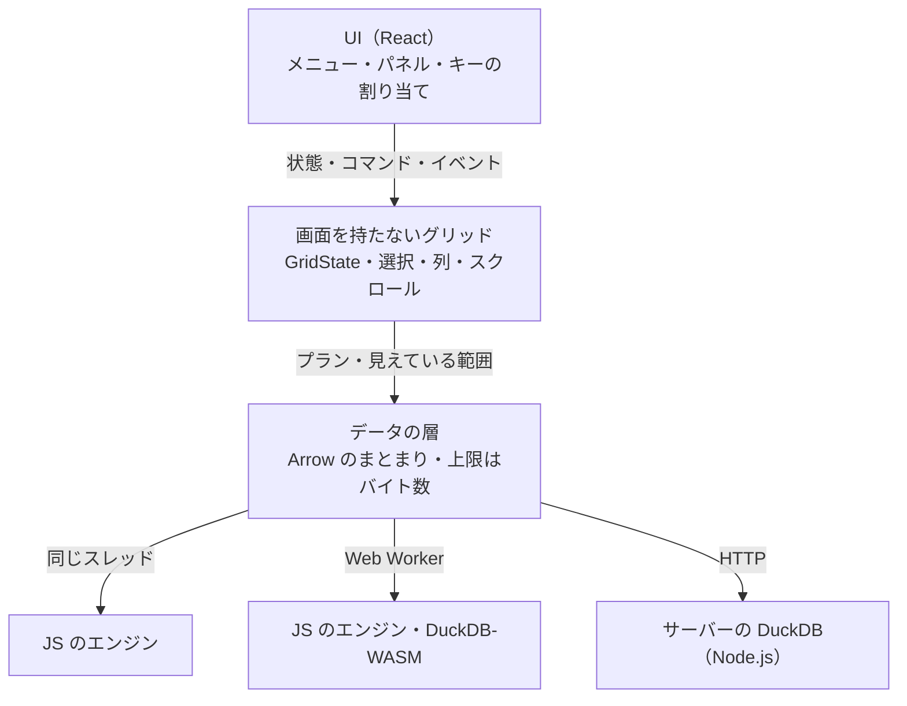

# vastgrid を作り直すときの設計案

検討日: **2026-10-24**。vastgrid は 0.1.1（基点: `674fbc7`）のソースコードと文書を対象としました。同じコンセプトのものを最初から作り直すとしたら、どういう設計にするか、今の設計とどこが違うかをまとめます。方針の提案で、決めたことではありません。測定した値と、構造から判断したことは分けて書きます。

**この設計案は、[作り直すかどうかの再検討](rebuild-decision.ja.md)で見直しました**（同じ日に、wave 3 まで統合した main の `7fa7bfb` を対象に）。7 つの柱は採り、進め方（作り直さずに近づける → v2 として作り直す）、重心（画面から切り離した状態と編集を先にする）、エンジンの組み合わせ（主役は Node.js の DuckDB、ブラウザーは JS のエンジン、DuckDB-WASM は任意）を変えています。以下は、0.1.1 を対象に書いたときのままです。

## 要点

**描画とスクロールの仕組みはほぼ残し、データ側の背骨を入れ替えます。** 今は「操作ごとのメソッド（`TableSource`）と、JSON で運ぶ値（`CellValue`）」が中心です。作り直すなら「クエリーのプラン」と「型を持つ列のデータ（Arrow）」を中心に置き、その上に次のものを載せます。

1. クエリーを、操作を並べた木（プラン）で表し、統計や検索もその上で表す
2. 値を、型を持つ列のまま運び、キャッシュに置く
3. エンジンを、同じスレッド・Web Worker・HTTP のどこでも同じ口で動かす。サーバーには状態を持たせない
4. ビューと読み込みを、最初の画面から段階的に良くする
5. グリッドの状態を画面から切り離し、保存・復元・制御できるようにする
6. 編集に備えて、変わらない行の ID と差分の置き場所を最初から持つ
7. 意味の仕様を 1 か所に書き、すべてのエンジンに同じテストを流す

0.1.1 の修正 21 件のうち 16 件は、値の型と意味（8 件）、ハンドルと読み込みの状態（6 件）、列の同一性（2 件）に関わるもので、2〜5 と 7 の変更で構造的に起きにくくなります（後述）。

## 前提

| 項目 | 内容 |
| --- | --- |
| ゴール | 数 GB・数億行の CSV・TSV・Parquet・JSON Lines を開き、表計算ソフトのように扱える React の部品。データの置き場所（サーバー・ブラウザー）を選べること（[既存調査](research.ja.md)の観点）。用途の中心は「巨大ファイルを素早く調べる」こと（[機能差の調査](feature-comparison.ja.md)） |
| 変えないコンセプト | キャンバスに描くグリッド、見えている所だけを読むこと、エンジンを差し替えられること、表計算ソフトの操作感 |
| 対象にした資料 | 3 つのパッケージのソースコード、README、[表のプロトコル](protocol.md)、[CHANGELOG](../CHANGELOG.md)、2 つの調査 |

## 全体像

3 つの運び方は、どれも同じ Engine のプロトコルを話します。ブラウザーの JS のエンジンも Worker で動かし、画面のスレッドでは計算しません。DuckDB の 2 つ（Node.js と WASM）は、プランから SQL を作る処理と、読み込み・ビューの組み立てを共有します。

パッケージの分け方の例です。

| パッケージ | 内容 | 今のどこにあたるか |
| --- | --- | --- |
| `core` | 画面を持たない（headless）グリッド。`GridState`、コマンド、選択、列、スクロール、まとまりのキャッシュ | `vastgrid-core` の選択・スクロール・キャッシュと、`GridController` の大半 |
| `react` | React の部品と、標準の UI（メニュー・パネル） | `vastgrid` |
| `query` | プランと式の型、検証、意味の仕様、Arrow の読み書き | `vastgrid-core` の型・プロトコル |
| `engine-js` | Worker で動く JS のエンジン | `ArraySource` |
| `engine-duckdb` | DuckDB のエンジン（Node.js と WASM）と、プランから SQL を作る処理 | `vastgrid-duckdb` の `engine.ts`・`sql.ts` |
| `server` | HTTP の受け口 | `vastgrid-duckdb` の `handler.ts` |

## 残すもの

| 残すもの | 理由 |
| --- | --- |
| キャンバスに描き、メニューやパネルを DOM で重ねる | 1 フレーム約 2 ms で、行数に左右されない。画面のスレッドを止めるのは描画ではなく `ArraySource` の計算とデータの解釈なので、描画は画面のスレッドのままでよい |
| ネイティブのスクローラーと `ScrollAxis` | OS 本来のスクロールのまま、要素の高さの上限を越えられる |
| 見えている所をまとまりで先読みし、遠ざかった要求を取り消すキャッシュ | 行数によらない読み込みの土台。列を表示の位置ではなくスキーマの番号で求めることも残す |
| DuckDB の隔離、組み立てた SQL とパラメーター、`ref` の解決をホストに任せること | 生成した SQL に誤りがあってもほかのファイルを読めない、という性質を保つ |
| 巨大な表のビューを行の順番だけで持つこと、読み込み中のプレビュー、文字コードの変換、`null_padding` | 調査と実測で選んだもので、置き換える理由がない |
| Excel に合わせた選択とキー操作、固定の行の高さ | 行の高さが固定なら、10 億行でも位置の計算が O(1) で済む |

## 変えるもの

| 項目 | 今の設計 | 作り直すなら |
| --- | --- | --- |
| 1. クエリー | 操作ごとのメソッド。`ViewQuery` は並べ替え・AND の絞り込み・検索の固定形 | 操作を並べた木（プラン）と式の木。統計・値の一覧・集計・検索もプランで表す |
| 2. 値 | JSON の `CellValue`。64 ビットの整数・小数・日時は文字列 | 型を持つ列（Arrow）で運び、そのままキャッシュに置く |
| 3. エンジンと通信 | 大きなファイル向けは Node.js の DuckDB だけ。サーバーが払い出すハンドル、`POST` と `no-store` | 3 つの運び方で同じプロトコル。識別子はプランのハッシュ。HTTP のキャッシュとイベントを使う |
| 4. ビューと読み込み | 全部できるまで待つ。読み込み中はプレビューだけ | 最初の画面、全体の順番、並べ替えた複製の順に良くなる |
| 5. 状態 | `GridController` が抱え、外から変えられるのはクエリーだけ | 画面から切り離した `GridState` をコマンドで変え、保存・復元・制御できる |
| 6. 編集への備え | 行は元の位置でしか見分けられず、書き込みの口がない | 変わらない行の ID、ID をキーにした差分、行からバイトの範囲への索引 |
| 7. 正しさの担保 | パッケージごとのテスト | 意味の仕様と、全エンジン共通のテスト |

### 1. クエリーのプランを中心にする

今の [`TableSource`](../packages/core/src/source.ts) は、操作ごとのメソッドでできています。必須の `info`・`createView`・`readRows` と、任意の `columnStats`・`distinctValues`・`aggregate`・`find`・`exportView`（ほかに `close`）です。`ViewQuery` は「並べ替え・AND でつなぐ絞り込み・検索」の固定形です。列をまたぐ OR や計算列を足すには、型、`parseProtocolRequest` の検証、`ArraySource`、`sql.ts`、画面をすべて変える必要があり、[機能差の調査](feature-comparison.ja.md)もそう指摘しています。

作り直すなら、クエリーを次の操作を並べた木（プラン）で表します。

| 操作 | 内容 |
| --- | --- |
| `scan` | 表を読む |
| `filter` | 式が真の行を残す |
| `derive` | 式で列を足す（計算列） |
| `aggregate` | 列でまとめて集計する（グループごとの集計） |
| `sort` | 並べ替える |
| `slice` | ビューの中の位置で範囲を切り出す |

式も木にします。列、値、比較、AND・OR・NOT、含む・始まる・終わる、空白の判定、四則演算、型の変換、日付の関数です。

- 列の統計、値の一覧、選択範囲の集計、検索（⌘F）は、専用の操作ではなくプランで表します。たとえば値の一覧は「`aggregate`（列でまとめて件数を数える）→ `sort` → `slice`」です。
- エンジンは、扱える操作と関数を返します。グリッドはそれを見て機能を有効にします。今の `capabilities` は、ここから導かれます。
- 機能差の調査で挙がっている「列をまたぐ OR・入れ子の条件」「計算列」「グループ化・小計」は、ほとんどが画面と、プランから SQL を作る処理の仕事になります。画面の状態の保存や URL への記録も、プランを JSON で残すだけです。
- 書き出しも「プランの結果を流す」ことになり、CSV や Parquet のストリームで返せばブラウザーへのダウンロードになります。今の `exportView` は、ホストが決めたサーバー上のパスに書くだけです。

安全性は今と同じ考え方で保ちます。[Mosaic](https://github.com/uwdata/mosaic) は、画面の部品が組み立てたクエリーを SQL の文字列にして、DuckDB（ブラウザーの WASM か、ネットワーク越しのサーバー）で実行します。vastgrid のサーバーは信頼できない画面に公開することがあるので、SQL の文字列は受け取りません。閉じた型の木を検証し、ノードの数・グループの数・実行時間に上限を設け、SQL は今と同じく組み立てて、値はパラメーターで渡します。

### 2. 値を型を持つ列で運び、そのまま持つ

今は値を `CellValue`（`string | number | boolean | null`）として JSON で運びます（[types.ts](../packages/core/src/types.ts)）。JavaScript の数で正確に表せない 64 ビットの整数・小数と、日時は文字列です。そのため、文字列から元の値を読み直す処理が層ごとにあります。

- `ArraySource` の `decimalOf`・`exactNumber`（[array-source.ts](../packages/core/src/array-source.ts)）
- 絞り込みの画面の `comparable`（[filter-panel.tsx](../packages/react/src/components/filter-panel.tsx)）
- DuckDB のエンジンの `decimalBound`（[sql.ts](../packages/duckdb/src/sql.ts)）

表示のために切った文字列も、値の末尾の「…」で表しています。`mayBeCut`（[controller.ts](../packages/react/src/controller.ts)）は、末尾が「…」かどうかで切られたかを推測します。キャッシュは既定で最大 600 個のまとまり（256 行 × 48 列）、つまり約 740 万セルを JavaScript の値として持つことがあり、その横に表示用の文字列も持ちます（[cache.ts](../packages/core/src/cache.ts)）。

作り直すなら、行のまとまりを [Apache Arrow](https://arrow.apache.org/docs/format/Columnar.html) の列で運びます。

- 64 ビットの整数、桁数（scale）を持つ小数、タイムゾーンを持つ日時、辞書にまとめた文字列、null かどうかを 1 ビットずつ持つビットマップを使います。
- 受け取った列のまま、キャッシュに置きます。上限はまとまりの数ではなく、バイト数で決めます。
- 「表示のために切った」という印は、値の外に別のビットマップで持ちます。
- 制御のやり取り（表を開く、状態を知る）は JSON のまま、行のまとまりだけをバイナリにします。

日時が型を持つので、ロケールやタイムゾーンに合わせた表示も、列ごとの書式も素直に作れます。Worker との受け渡しも、配列をコピーせずに移せます。

なお、`@duckdb/node-api` 1.5.6 の型定義には、結果を Arrow で書き出す API が見当たりません。拡張をネットワークから取得するのは、エンジンを隔離する方針と合いません。Node.js では `fetchChunk()` で得たベクトルから列のバッファを組み立てます。DuckDB-WASM はもともと結果を Arrow で返します。

### 3. エンジンをどこでも同じ口で動かし、サーバーに状態を持たせない

今の構成には、次の制約があります。

- 大きなファイル向けに同梱しているエンジンは、Node.js の DuckDB だけです。`ArraySource` は画面のスレッドで全行をたどります（[性能](../site/src/content/docs/ja/about/performance.md)の測定では、30 万行の小数の列の並べ替えが 0.55 秒）。
- プロトコルは、サーバーが払い出す表とビューのハンドルに頼っています。`RemoteSource` は、サーバーが忘れたビューを作り直すための対応表（`queries`・`aliases`・`recreating`）を持ちます（[remote-source.ts](../packages/core/src/remote-source.ts)）。
- ビューは表ごとに 2 つまで（`maxViews`）で、表は同じファイルを開いた利用者の間で共有されます（[engine.ts](../packages/duckdb/src/engine.ts)）。別々の並べ替えが 3 つ重なると、互いのビューを消し合い、作り直しになります。
- 応答は `POST` と `Cache-Control: no-store` で（[handler.ts](../packages/duckdb/src/handler.ts)）、ブラウザーや CDN のキャッシュが使えません。
- 読み込みの進み具合は、`info` をポーリングして知ります。

作り直すなら、次のようにします。

- Engine のプロトコルを 1 つにして、運び方を 3 つ用意します。同じスレッド（テストや小さな表）、Web Worker の postMessage、HTTP です。
- エンジンは、Worker で動く JS のエンジン、Worker で動く DuckDB-WASM、Node.js の DuckDB を最初からそろえます。DuckDB の 2 つは、プランから SQL を作る処理と、読み込み・ビューの組み立てを共有します。調査の観点の「データの置き場所を選べる」を、最初から満たします。
- 識別子は、払い出すハンドルではなく「ファイルの revision ＋ プランのハッシュ」にします。サーバーはこれをキーに、決めた量までビューをキャッシュし、なければ作り直すだけです。同じ要求には同じ結果を返すので、行の取得を `GET` にして、ブラウザーや CDN に長く保存させられます（`Cache-Control: immutable`）。`RemoteSource` の対応表も要らなくなります。
- 読み込みの進み具合や revision の変化は、ポーリングではなくイベント（Server-Sent Events など）で送ります。

### 4. ビューと読み込みを段階的に良くする

今の `createView` は、並べ替えや絞り込みの結果が全部できるまで返りません。CSV と JSON は、読み込みが終わるまで先頭の 1,000 行のプレビューしか読めず、並べ替え・絞り込み・統計はすべて使えません（`OpenTable.info` の `capabilities` が `ready` に連動しています）。

作り直すなら、ビューに段階を持たせます。

1. 最初の画面: 並べ替えなら上位の 256 行、絞り込みなら先頭の 256 行だけを求めて、すぐに返す
2. 全体の順番: 行の順番の表を作り、どの位置へも移れるようにする
3. 並べ替えた複製: 必要なら裏で作り、できたら読み先を切り替える

行数は「少なくとも N 行」から確定した値へ更新し、段階が上がったらキャッシュのまとまりを読み直します。読み込み中の CSV でも、読めた所までを対象に、途中であることを示して絞り込みや統計を使えるようにします。

測定では、並べ替えの最初の画面が、1,000 万行で約 1.3〜1.6 秒から約 0.1 秒に、1 億行で約 4〜7 秒から約 1〜1.4 秒になりました（後述）。1 億行では 2 の段階でも中ほどのまとまりに 0.4〜0.5 秒かかるので、3 の段階まで含めて効きます。ロードマップの「1 億行を超える並べ替えで、並べ終わる前に先頭を表示する」は、1 の段階にあたります。

### 5. 状態を画面から切り離す

今は [`GridController`](../packages/react/src/controller.ts)（945 行）が、読み込み・列・選択・スクロール・コピー・検索・集計を 1 つの書き換え可能なオブジェクトに持ち、[`DataGrid`](../packages/react/src/data-grid.tsx)（1,035 行）が入力・メニュー・パネルを持ちます。外から変えられるのはクエリーだけです（`setQuery`・`onQueryChange`）。

- 選択は表示の位置で持つので（[selection.ts](../packages/core/src/selection.ts)）、列を隠すと別の列を指します。
- 列の幅や表示の設定はスキーマの番号で持ち、ファイルを読み直したときに名前で付け直しています（`applyInfo`）。

作り直すなら、次のように分けます。

- `GridState`: JSON で保存・復元でき、版を持ちます。列の ID ごとの幅・順番・表示・固定・書式、プラン、列の ID で表した選択、行と行内の位置で表したスクロールの位置を持ちます。
- コマンド: `GridState` を変える処理（並べ替える、絞り込む、列の幅を変える、選ぶ）を、画面から独立した関数にします。データの取得は、状態の変化に反応する別の層が受け持ちます。
- React の部品: `state`・`defaultState`・`onStateChange` と、選択・列・セルの操作のイベントを持ちます。キーの割り当てとメニューの項目は、データとして差し替えられるようにします。
- 列の定義: 書式、条件つきの色、独自の描画と、その当たり判定を持たせます。

機能差の調査の 1 位（画面状態の保存・復元）と 2 位（列ごとの書式とセルの描画）は、ここで片付きます。

### 6. 編集に備えたデータの持ち方

今は行を元の表での位置でしか見分けられず、書き込みの口もありません。一方、ロードマップには「変えていない行を 1 バイトも変えない CSV への書き戻し」があります。

作り直すなら、元のファイルを正とし、DuckDB の表は調べるための複製と位置づけます。

- 行には、変わらない ID を持たせます（ファイルでは元の行番号、データベースでは主キー）。
- 編集は、ID をキーにした差分として重ねます。読み出しにもクエリーにも反映します（SQL では差分の表と結合します）。
- 保存では「行 → バイトの範囲」の索引を使い、触っていない行は元のバイトのまま書き、変えた行だけを書き直します。

編集の機能そのものは後でかまいません。ただ、行の ID と差分の置き場所は最初の設計に入れておきます。索引の区切り方（引用符の中の改行、見出しの行、空の行）を DuckDB の行の数え方と一致させる必要があり、ここが最大のリスクです。

### 7. 意味の仕様と、全エンジン共通のテスト

今のテストはパッケージごとにあり、`ArraySource` と DuckDB の振る舞いの違い（空文字の並び順、小数、巨大な整数、NaN）は後から見つかって直しています。

作り直すなら、次のようにします。

- 空白、文字列の比べ方、大文字と小文字、数の比べ方、NaN、タイムゾーンの意味を 1 か所に書きます。
- （表・プラン・期待する結果）の組と、ランダムに作った表とプランで結果を突き合わせるテストを、すべてのエンジンに同じように流します（適合テスト）。
- 入力と描画はブラウザーで（Playwright）、性能はしきい値を決めて CI で確かめます。

## 測定: 並べ替えと絞り込みの最初の画面

段階的なビューの効果を、今の DuckDB のエンジンで測りました。

- 環境: Apple M2 Pro（12 スレッド・メモリ 32 GB）、macOS 27.0.1、Node.js 24.21、`@duckdb/node-api` 1.5.6（DuckDB 1.5）。エンジンは既定の設定です。
- データ: `npm run bench` が作る `sales-10000000.parquet`（1,000 万行）と `sales-100000000.parquet`（1 億行）。
- 今の方式: `OpenTable.createView` と、`readRows` で読む 256 行 × 8 列のまとまり。1,000 万行は `materializeRows`（2,000 万行）以下なので並べ替えた複製を、1 億行は行の順番だけを作ります。
- 段階的な方式の 1 の段階: 同じ DuckDB で、次の SQL を直接実行しました。
  - 並べ替え: `SELECT file_row_number FROM read_parquet(…, file_row_number=true) ORDER BY price NULLS LAST, file_row_number LIMIT 256` で位置を求め、`WHERE file_row_number IN (…)` でその行を読む
  - 絞り込み: `… WHERE coalesce(city IN ('Osaka'), FALSE) ORDER BY file_row_number LIMIT 256`
- 予行を 1 回してから 3 回測り、最小〜最大を示します。
- **測定の間、ほかの処理でマシンの負荷が高い状態でした（load average 約 30）。** 絶対値は README の測定（1 億行の並べ替え 1.9 秒、並べ替え後のまとまり 147 ms）より大きく出ています。同じ条件で続けて測った、2 つの方式の差を見てください。

| 処理 | 1,000 万行 | 1 億行 |
| --- | ---: | ---: |
| 並べ替え（`price`）: 今のビューを作る | 1.28〜1.58 秒 | 3.92〜6.52 秒 |
| 並べ替え: 今のビューの最初のまとまり | 2〜6 ms | 204〜253 ms |
| 並べ替え: 今のビューの中ほどのまとまり | 3〜4 ms | 415〜535 ms |
| 並べ替え: 上位 256 行の位置を求める | 30〜33 ms | 663〜859 ms |
| 並べ替え: その 256 行を読む | 56〜66 ms | 352〜511 ms |
| 絞り込み（`city = 'Osaka'`）: 今のビューを作る | 217〜268 ms | 309〜513 ms |
| 絞り込み: 今のビューの最初のまとまり | 2〜4 ms | 42〜84 ms |
| 絞り込み: 先頭の 256 行だけを読む | 9〜11 ms | 38〜60 ms |

最初の画面が出るまでを足すと、次のとおりです。

| 処理 | 1,000 万行 | 1 億行 |
| --- | ---: | ---: |
| 並べ替え: 今 → 段階的 | 約 1.3〜1.6 秒 → 約 0.09〜0.1 秒 | 約 4.1〜6.8 秒 → 約 1.0〜1.4 秒 |
| 絞り込み: 今 → 段階的 | 約 0.22〜0.27 秒 → 約 0.01 秒 | 約 0.35〜0.6 秒 → 約 0.04〜0.06 秒 |

並べ替えは 1,000 万行でも、最初の画面までがおよそ 15 分の 1 になります。1 億行では 4〜5 分の 1 ですが、行の順番だけを持つビューは中ほどのまとまりにも 0.4〜0.5 秒かかるので、3 の段階（並べ替えた複製）まで含めて効きます。絞り込みは今でも 0.6 秒以内に収まり、段階的にする効果は、待ち時間よりも、入力に合わせて結果がすぐ変わることにあります。

## 0.1.1 の修正から見た根拠

[CHANGELOG](../CHANGELOG.md) の 0.1.1 にある修正 21 件を、原因の種類で分けました（分け方はこの文書の判断です）。

| 種類 | 件数 | 修正の例 | 起きにくくする変更 |
| --- | ---: | --- | --- |
| 値の型と意味 | 8 | 小数の比較の境界、`ArraySource` の小数と巨大な整数、統計の NaN、空文字の並び順、切った文字列による値の一覧とコピーの誤り、絞り込みの画面での巨大な整数 | 2・7 |
| ハンドル・読み込みの状態・同時実行 | 6 | 読み込みの失敗が伝わらない、ビューの要求が互いに取り消す、変わったファイルを同時に開く、忘れられたビューの作り直し、失敗したまとまりの読み直し、サーバーが取り消したビュー | 3・4 |
| 列の同一性 | 2 | 読み直したときに、並べ替え・絞り込みと列の幅を列の名前で付け直す | 5 |
| そのほか | 5 | UTF-16 の BOM、実際の場所での確認、`rowid` という名前の列、エラーの文面、1 回に読むセルの上限 | — |

21 件のうち 16 件が、2〜5 と 7 の変更で構造的に起きにくくなる種類です。

## 作り直さずに近づける順番

0.x のうちは、一度に書き直すより、次の順に移るのが現実的です。

| 段階 | 内容 | 理由・注意点 |
| --- | --- | --- |
| 1 | `GridState`・列の ID・イベントを入れる | プロトコルを変えずに、機能差の調査の 1 位と 2 位に答えられる。保存する形式には版を持たせる |
| 2 | 絞り込みを式の木（AND・OR）にする | プランの最初の一歩。プロトコルは v2 として旧い形式も受ける。`sql.ts` と `ArraySource` を同じ意味で実装し、共通のテストを始める |
| 3 | `ArraySource` を Worker で動く JS のエンジンにする | 画面のスレッドを止めない。postMessage での運び方は、DuckDB-WASM の足場になる |
| 4 | 行のまとまりを Arrow にする | `Accept` で JSON と切り替える。キャッシュの上限をバイト数にする |
| 5 | 段階的なビュー | 並べ替えの最初の画面を上位 256 行で出す。行数が後から決まる表示を画面に入れる。ほかの段階と独立しているので、待ち時間を先に減らしたいなら前に出せる |

編集（6）は、1〜4 が済んでから、別の設計として進めます。

## 代償とリスク

- プランは表現力と引き換えに、検証、コストの上限、すべてのエンジンでの実装が要ります。最初は `filter`・`sort`・`slice`・`aggregate` に絞ります。
- プランのハッシュを識別子にするには、同じ意味のプランが同じ形になるよう正規化する必要があります（キーの順番、既定値の省略）。
- Arrow の依存が増えます。必要な型だけを読むデコーダーを自作する手もあります。
- Worker をライブラリとして配るのは、バンドラーごとに `new Worker(new URL(…, import.meta.url))` の扱いが違うため手間がかかります。DuckDB-WASM はファイルが大きく、[既存調査](research.ja.md)にあるとおり、メモリは 4 GB まで、CSP に `'wasm-unsafe-eval'`、並列には COOP・COEP の設定が要ります。
- 段階的なビューでは、行数が後から変わる状態を画面が扱う必要があります（スクロールバーの長さ、行数の表示）。
- 行からバイトの範囲への索引は、DuckDB の行の数え方と一致させないと、書き戻しで行を取り違えます。

## 確認した実装

| 確認対象 | 根拠 |
| --- | --- |
| エンジンとの口、値と絞り込みの型 | [source.ts](../packages/core/src/source.ts) の `TableSource`、[types.ts](../packages/core/src/types.ts) の `CellValue`・`ViewQuery`・`Filter` |
| キャッシュの既定値（256 行 × 48 列、600 個） | [cache.ts](../packages/core/src/cache.ts) の `RowCache` |
| ハンドルとビューの作り直し | [remote-source.ts](../packages/core/src/remote-source.ts) の `RemoteSource` |
| 選択を表示の位置で持つこと | [selection.ts](../packages/core/src/selection.ts) の `SelectionModel` |
| 状態・ポーリング・列の付け直し・切った文字列の推測 | [controller.ts](../packages/react/src/controller.ts) の `GridController`（`poll`・`applyInfo`）と `mayBeCut` |
| 入力・メニュー・外から使える API | [data-grid.tsx](../packages/react/src/data-grid.tsx) の `DataGridProps`・`DataGridHandle` |
| ビューの数と作り方、読み込み中にできること | [engine.ts](../packages/duckdb/src/engine.ts) の `TableEngine.create`・`OpenTable.info`・`buildView` |
| 文字列からの読み直し | [array-source.ts](../packages/core/src/array-source.ts) の `decimalOf`・`exactNumber`、[filter-panel.tsx](../packages/react/src/components/filter-panel.tsx) の `comparable`、[sql.ts](../packages/duckdb/src/sql.ts) の `decimalBound` |
| 応答のキャッシュの指定 | [handler.ts](../packages/duckdb/src/handler.ts) の `json` |
| Arrow で書き出す口の有無 | `@duckdb/node-api` 1.5.6 の型定義（`DuckDBResult.fetchChunk`・`DuckDBDataChunk.getColumnVector`） |

## 出典

- Mosaic: https://github.com/uwdata/mosaic
- Apache Arrow の列の形式: https://arrow.apache.org/docs/format/Columnar.html
- DuckDB-WASM: https://github.com/duckdb/duckdb-wasm
