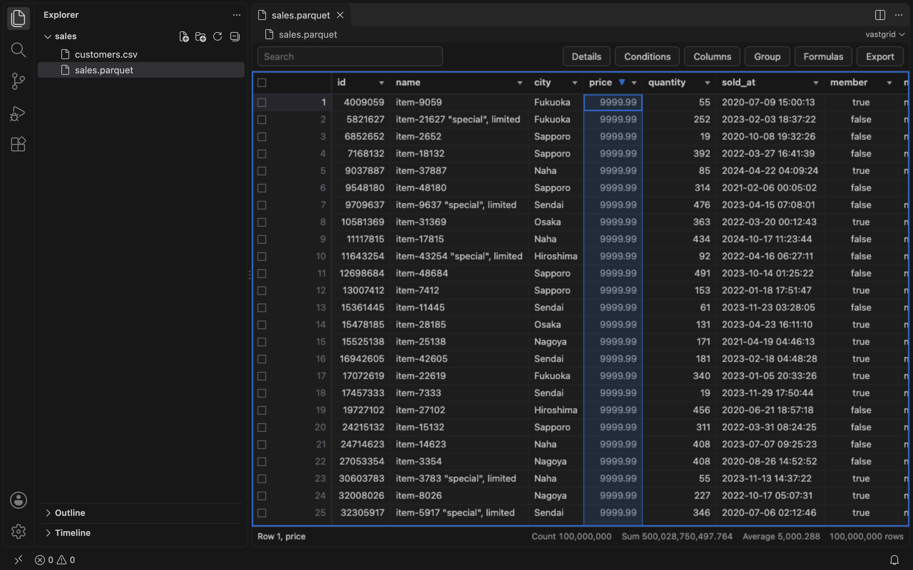
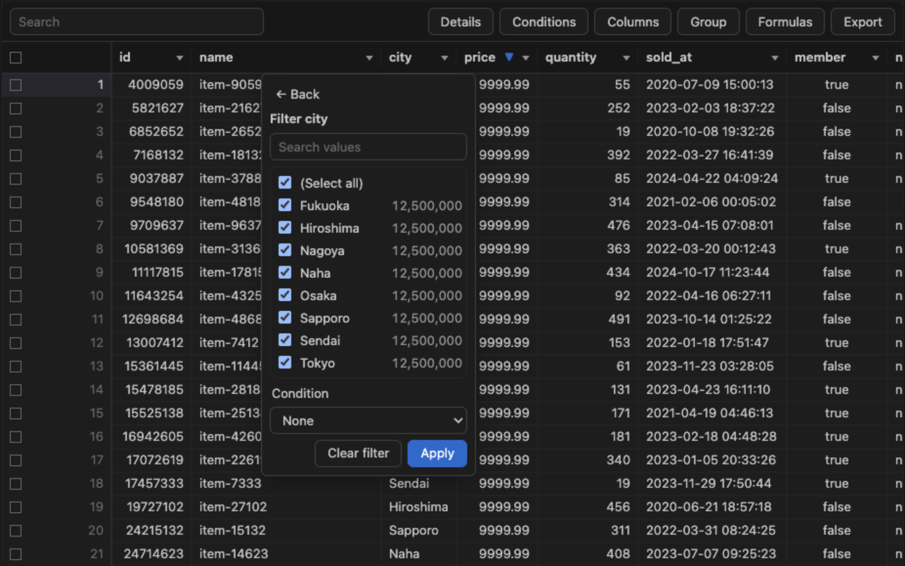
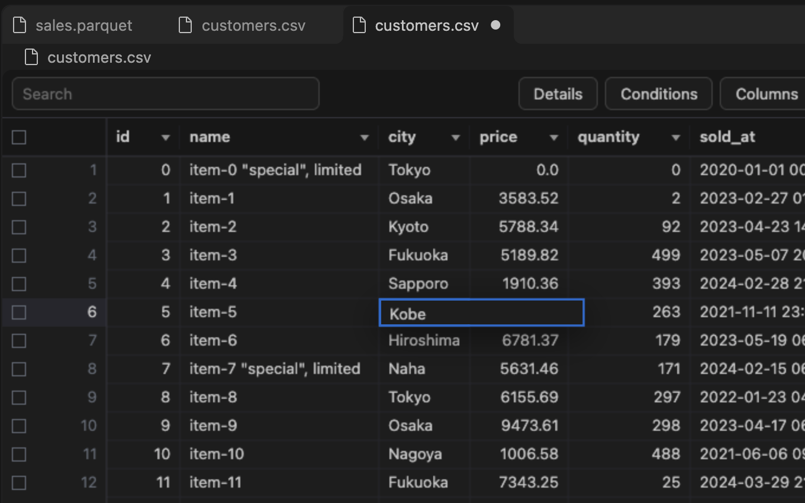

# vastgrid for VS Code

CSV, TSV, Parquet, JSON Lines and Excel files of any size open in a grid, read by DuckDB in the extension: scroll to
the last row of a file of 100,000,000 rows, sort, filter and group the whole file, and edit the cells of CSV and TSV
files and save them with VS Code's Save, which rewrites only the edited fields and keeps every other byte.

## Opening files

| Format | Files | In vastgrid |
| --- | --- | --- |
| CSV, TSV | `.csv`, `.tsv`, `.tab` | edited and saved |
| CSV, TSV compressed | `.csv.gz`, `.csv.zst`, `.tsv.gz`, `.tsv.zst` | read |
| JSON Lines | `.jsonl`, `.ndjson` (also `.gz`) | read |
| Parquet | `.parquet`, `.pq` | read, by default |
| Excel | `.xlsx`, `.xlsm` | read, by default; the bar above the grid, or "vastgrid: Choose Sheet", chooses the sheet |

Parquet and Excel files open in vastgrid when they are opened. CSV, TSV and JSON Lines files open as text, as
before: vastgrid opens them with the editor's "Open in vastgrid" button, the explorer's "Open in vastgrid", or "Open
With…". "Get Started with vastgrid", on VS Code's Welcome page, shows the way around.

## Exploring them

- **Sort** by a column with a click on its name, and by more with Shift + click.
- **Filter** with a column's menu, which lists its values with how many rows have each, or with conditions (Equals,
  Contains, Between, Is blank, …) on any column. The toolbar's search keeps the rows where any column has the text.
- **Group** rows by columns, with counts, sums and other totals, and add computed columns with formulas.
- **Count, sum and average** a selection of any size in the status bar, **find** text with ⌘F or Ctrl+F, and see a
  column's **statistics**.
- **Export** the view as CSV, TSV, Parquet, JSON or Excel.

DuckDB does each of these over the whole file, not over the rows on screen.

## Editing CSV and TSV files

- Type, paste, clear and fill cells. VS Code's Undo and Redo undo and redo them, and the editor is dirty while the
  cells differ from the file.
- Save writes only the edited fields; a file that someone else changed since it was read is not saved over. Save As
  writes the table, with its edits, as CSV, TSV, Parquet, JSON or Excel.
- Hot exit keeps the cells not saved in VS Code's backups, and writes them again when the window opens, unless the
  file changed since.

## Installing

Install it from the [Visual Studio Marketplace](https://marketplace.visualstudio.com/items?itemName=yhay81.vastgrid-vscode)
(`code --install-extension yhay81.vastgrid-vscode`) or, in VSCodium and other editors, from
[Open VSX](https://open-vsx.org/extension/yhay81/vastgrid-vscode). Each version's
`vastgrid-vscode-<version>-<target>.vsix` files are also on its GitHub release.

- **Platforms**: VS Code 1.100 or later on macOS (arm64, x64), Linux (x64, arm64; glibc and musl) and Windows (x64,
  arm64), each with a package of its own that carries DuckDB's bindings for it.
- **Trust**: in a workspace that VS Code does not trust, files open read-only until it is trusted.
- **Privacy**: the extension reads files on disk only, and sends nothing over the network.

More in [docs/vscode.md](https://github.com/yhay81/vastgrid/blob/main/docs/vscode.md). The same grid is also a
command, an MCP App and a Jupyter widget, and a React component for apps: see
[vastgrid.yhay81.com](https://vastgrid.yhay81.com).
